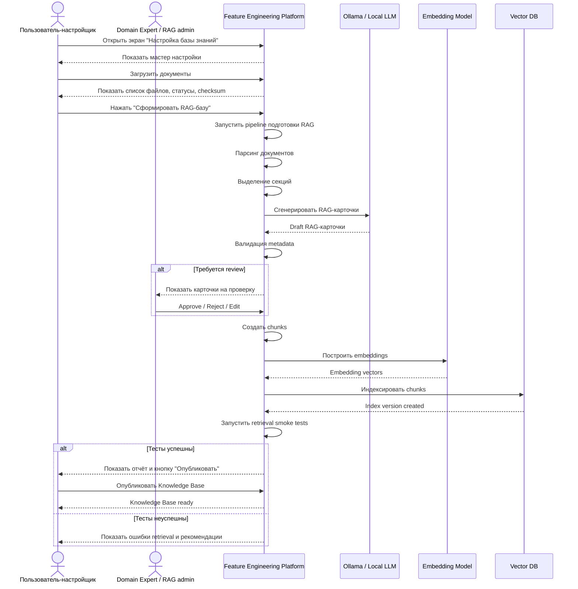
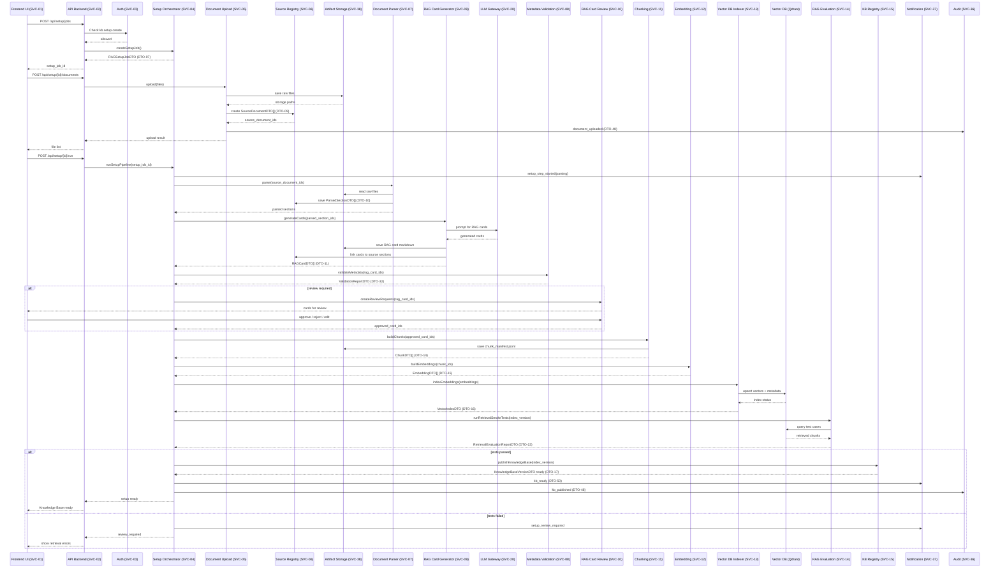

# SETUP-01. Пользовательский мастер настройки базы знаний

## 1. Назначение фичи

**Краткое название.** SETUP-01. Пользовательский мастер настройки базы знаний.

**Краткое описание.** Фича предоставляет пользователю единый интерфейс настройки RAG-базы: загрузка исходных документов, запуск обработки, просмотр прогресса pipeline, контроль ошибок, review сгенерированных RAG-карточек, запуск индексации, проверка retrieval smoke tests, публикация Knowledge Base и получение финального статуса готовности.

**Какую проблему решает.** Без этой фичи подготовка RAG-базы остаётся скрытой backend-операцией или ручным техническим процессом. Пользователь не понимает, какие документы загружены, какие карточки созданы, какие chunks проиндексированы, почему RAG не готов и можно ли запускать мультиагентный Feature Engineering Bot. Фича делает настройку RAG наблюдаемой, управляемой и подтверждаемой пользователем.

**Место в жизненном цикле.** Начальный этап работы системы:

```text
пользователь загружает знания
  → система формирует RAG-корпус
  → пользователь подтверждает качество
  → система строит векторную БД
  → система сообщает «Knowledge Base ready»
  → пользователь запускает Feature Engineering Bot
```

## 2. Контекст и бизнес-цель

### 2.1. Бизнес-контекст

Фича используется в процессе первичной настройки системы под конкретный домен, проект или организацию. Пользователь может загрузить материалы предметной области: описания задач, схемы данных, аналитические документы, глоссарии, справочники, feature-store описания, правила валидации, документы с бизнес-требованиями.

Текущие pain points:

```text
- RAG-база не может быть качественной без структурированной подготовки.
- Маленькая LLM не может надёжно работать с сырыми документами.
- Пользователь не видит, готова ли база знаний.
- Нет прозрачности: какие документы попали в RAG, какие нет, где ошибки.
- Нет контролируемого момента публикации Knowledge Base.
```

Если RAG не готов или плохо размечен, агенты будут генерировать признаки без достаточного evidence, ошибаться в доменных терминах, предлагать невычислимые признаки и выбирать нерелевантные модели.

### 2.2. Бизнес-цель

Ожидаемый эффект:

```text
- снизить ручную трудоёмкость подготовки RAG-базы;
- ускорить подключение нового домена;
- повысить качество retrieval;
- сделать подготовку базы знаний управляемой через UI;
- обеспечить прослеживаемость: source document → RAG card → chunk → vector index → Evidence Pack;
- снизить риск галлюцинаций агентов за счёт evidence-based работы.
```

KPI MVP:

| Метрика | Целевое значение |
| --- | --- |
| Доля успешно обработанных документов | ≥ 90% |
| Доля RAG-карточек с валидной metadata | ≥ 95% |
| Доля chunks, успешно проиндексированных в Vector DB | ≥ 98% |
| Retrieval smoke test pass rate | ≥ 80% для MVP |
| Время от загрузки документов до статуса `ready` | ≤ 10 минут для малого корпуса |
| Доля setup-сессий, завершённых публикацией KB | ≥ 70% |
| Доля карточек, требующих ручного review | отслеживается, целевой ориентир ≤ 30% |

Успешный результат:

```text
Пользователь загружает документы через фронт,
запускает настройку,
видит прогресс,
проверяет RAG-карточки,
публикует базу знаний
и получает статус Knowledge Base ready.
```

### 2.3. Инициатор и заинтересованные стороны

**Инициатор:** владелец продукта / архитектор мультиагентной системы.

**Затрагиваемые команды:** Frontend, Backend, RAG / Knowledge Engineering, ML / Data Science, DevOps / MLOps, Domain experts, QA.

**Решение о запуске:** Product Owner совместно с архитектором и владельцем RAG-процесса.

## 3. Термины и определения

| Термин | Определение |
| --- | --- |
| RAG | Retrieval-Augmented Generation. В проекте — metadata-aware knowledge workflow, не простой vector search (см. [rag-methodology.md](../../06-rag/rag-methodology.md)) |
| Knowledge Base / KB | Опубликованная версия RAG-корпуса, доступная runtime-агентам ([DTO-17](../../03-architecture/services/data-transfer-objects.md#dto-17-knowledgebaseversiondto)) |
| Source Document | Файл, загруженный пользователем: md / pdf / docx / xlsx / csv / json ([DTO-09](../../03-architecture/services/data-transfer-objects.md#dto-09-sourcedocumentdto)) |
| Parsed Section | Смысловой фрагмент исходного документа ([DTO-10](../../03-architecture/services/data-transfer-objects.md#dto-10-parsedsectiondto)) |
| RAG Card | Структурированный Markdown-документ с YAML metadata ([DTO-11](../../03-architecture/services/data-transfer-objects.md#dto-11-ragcarddto)) |
| Chunk | Логическая часть RAG-карточки, индексируемая в Vector DB ([DTO-14](../../03-architecture/services/data-transfer-objects.md#dto-14-chunkdto)) |
| Embedding | Числовое представление текста chunk ([DTO-15](../../03-architecture/services/data-transfer-objects.md#dto-15-embeddingdto)) |
| Vector DB | Хранилище embeddings и chunk metadata (Qdrant; см. [ADR-003](../../03-architecture/adr/ADR-003-qdrant-as-vector-db.md)) |
| Retrieval Smoke Test | Набор контрольных запросов для проверки готовности RAG ([DTO-21](../../03-architecture/services/data-transfer-objects.md#dto-21-retrievalevaluationcasedto), [DTO-22](../../03-architecture/services/data-transfer-objects.md#dto-22-retrievalevaluationreportdto)) |
| Setup Job | Долгая операция подготовки RAG-базы ([DTO-07](../../03-architecture/services/data-transfer-objects.md#dto-07-ragsetupjobdto)) |
| Evidence Pack | Сжатый RAG-контекст для агента ([DTO-20](../../03-architecture/services/data-transfer-objects.md#dto-20-evidencepackdto)), формируется в runtime |

### Статусы Setup Job

| Статус | Значение |
| --- | --- |
| `draft` | Job создан, но обработка ещё не запущена |
| `files_uploaded` | Файлы загружены и зарегистрированы |
| `parsing` | Идёт парсинг документов |
| `sections_extracted` | Секции извлечены |
| `rag_cards_generating` | Идёт генерация RAG-карточек |
| `metadata_validating` | Идёт проверка metadata |
| `review_required` | Требуется пользовательское review |
| `chunking` | Идёт генерация chunks |
| `embedding` | Идёт построение embeddings |
| `indexing` | Идёт индексация Vector DB |
| `retrieval_testing` | Идут retrieval smoke tests |
| `publishing` | Публикуется Knowledge Base |
| `ready` | Knowledge Base готова |
| `failed` | Настройка завершилась ошибкой |
| `cancelled` | Пользователь отменил обработку |

## 4. Границы фичи

### 4.1. In Scope

Входит в реализацию:

```text
- экран настройки базы знаний;
- загрузка файлов через UI;
- отображение списка загруженных файлов;
- регистрация source documents;
- запуск setup pipeline;
- отображение прогресса pipeline;
- парсинг документов;
- генерация RAG-карточек;
- валидация metadata;
- отображение карточек, требующих review;
- подтверждение / отклонение / отправка на регенерацию RAG-карточек;
- генерация chunks;
- построение embeddings;
- индексация Vector DB;
- retrieval smoke tests;
- публикация Knowledge Base;
- финальное сообщение Knowledge Base ready;
- processing report;
- audit событий настройки;
- базовая аналитика setup job.
```

Затрагиваемые экраны:

```text
- Knowledge Base Setup Page
- Source Documents Table
- Setup Progress Timeline
- RAG Card Review Panel
- Retrieval Test Report Panel
- Knowledge Base Ready Banner
```

### 4.2. Out of Scope

Не входит в реализацию SETUP-01 (реализуется отдельными фичами):

```text
- runtime-диалог Feature Engineering Bot         → RUNTIME-01..RUNTIME-12
- генерация признаков                            → RUNTIME-06
- генерация обучающей выборки                    → RUNTIME-10
- выбор ML-модели                                → RUNTIME-11
- экспорт ML-пакета                              → RUNTIME-12
- полноценная админ-панель управления ontology   → отдельная фича post-MVP
- продвинутый редактор Markdown-карточек         → отдельная фича post-MVP
- production deployment KB в несколько окружений → отдельная фича post-MVP
- A/B тест retrieval policies                    → ANALYTICS-02 RAG Quality Analytics
```

### 4.3. Ограничения реализации

Технические:

```text
- размер файла ограничен настройкой системы;
- поддерживаемые форматы в MVP: md, txt, pdf, docx, xlsx, csv, json;
- OCR не входит в MVP;
- карточки без обязательной metadata не могут быть проиндексированы;
- draft / rejected / deprecated карточки не попадают в active KB;
- Vector DB индексируется только по approved chunks;
- setup job должен быть идемпотентным на уровне повторного запуска этапов;
- long-running этапы должны выполняться асинхронно;
- frontend должен получать progress events.
```

Организационные:

```text
- публикация KB требует роли rag_admin или admin с правом publish;
- карточки с low confidence требуют review;
- пользователь должен иметь доступ к загружаемым документам;
- для закрытых документов нужна настройка access control (см. rag-security.md).
```

MVP-ограничения:

```text
- один активный setup job на пользователя;
- одна active KB version на проект;
- базовые retrieval smoke tests;
- без сложного workflow согласования несколькими экспертами.
```

## 5. Пользовательские роли и внешние участники

### 5.1. Пользовательские роли

| Роль | Описание | Действия в рамках фичи |
| --- | --- | --- |
| Пользователь-настройщик | Готовит базу знаний для проекта | Загружает документы, запускает обработку, смотрит прогресс |
| RAG Admin | Отвечает за качество и публикацию RAG-базы | Проверяет карточки, исправляет metadata, публикует KB |
| Domain Expert | Проверяет доменный смысл сгенерированных карточек | Подтверждает или отклоняет RAG-карточки |
| ML Engineer | Использует готовую KB для runtime-сценариев | Проверяет, что база содержит нужные task/schema/analytics cards |
| Системный администратор | Поддерживает инфраструктуру | Следит за Vector DB, Object Storage, LLM, embedding model |
| Аудитор | Проверяет прослеживаемость source → card → chunk → index | Просматривает audit trail и processing report |

### 5.2. Внешние участники

| Участник | Тип | Роль во взаимодействии | Интерфейс |
| --- | --- | --- | --- |
| Пользователь-настройщик | Пользователь | Загружает документы и запускает setup | UI |
| RAG Admin | Пользователь | Публикует Knowledge Base | UI |
| Domain Expert | Пользователь | Review RAG-карточек | UI |
| Ollama / Local LLM (EXT-01) | Внешняя система | Генерирует RAG-карточки по parsed sections | HTTP / local API |
| Embedding Model | Внешняя система | Строит embeddings chunks | API / local runtime |
| Vector DB (Qdrant) | Инфраструктура | Хранит vector index | gRPC / HTTP |
| Object Storage (MinIO) | Инфраструктура | Хранит файлы и отчёты | S3 API |
| Identity Provider | Внешняя система | Авторизация и роли | OAuth / OIDC |

### 5.3. Права доступа

| Действие | Разрешённые роли |
| --- | --- |
| Открыть экран настройки | user, rag_admin, admin |
| Загружать документы | user, rag_admin, domain_expert |
| Запускать setup pipeline | user, rag_admin |
| Смотреть все setup jobs проекта | rag_admin, admin |
| Review RAG-карточек | rag_admin, domain_expert |
| Публиковать Knowledge Base | rag_admin, admin |
| Отменять setup job | владелец job, rag_admin, admin |
| Скачивать processing report | владелец job, rag_admin, admin |
| Смотреть audit trail | rag_admin, admin, auditor |

Минимальные permissions:

```text
kb.setup.create
kb.document.upload
kb.setup.run
kb.card.review
kb.publish
kb.report.read
```

## 6. Сервисы и системы-участники

### 6.1. Внутренние сервисы

| Сервис | Роль в фиче | Тип взаимодействия |
| --- | --- | --- |
| [SVC-01 Frontend UI](../../03-architecture/services/user-frontend.md) | Пользовательский интерфейс мастера | sync + streaming |
| [SVC-02 API Backend](../../03-architecture/services/user-frontend.md) | Единая точка входа для frontend | sync |
| [SVC-03 Auth Service](../../03-architecture/services/user-frontend.md) | Проверка прав доступа | sync |
| [SVC-04 Setup Orchestrator](../../03-architecture/services/setup-services.md) | Управляет pipeline настройки RAG | async orchestration |
| [SVC-05 Document Upload Service](../../03-architecture/services/setup-services.md) | Принимает и регистрирует документы | sync/async |
| [SVC-06 Source Registry Service](../../03-architecture/services/setup-services.md) | Хранит реестр источников | sync |
| [SVC-07 Document Parser Service](../../03-architecture/services/setup-services.md) | Парсит документы на секции | async |
| [SVC-08 Metadata Validation Service](../../03-architecture/services/setup-services.md) | Проверяет metadata и ontology | sync/async |
| [SVC-09 RAG Card Generator](../../03-architecture/services/setup-services.md) | Генерирует RAG-карточки | async + LLM call |
| [SVC-10 RAG Card Review Service](../../03-architecture/services/setup-services.md) | Управляет review карточек | sync |
| [SVC-11 Chunking Service](../../03-architecture/services/setup-services.md) | Создаёт chunks | async |
| [SVC-12 Embedding Service](../../03-architecture/services/setup-services.md) | Создаёт embeddings | async |
| [SVC-13 Vector DB Indexer](../../03-architecture/services/setup-services.md) | Индексирует chunks в Vector DB | async |
| [SVC-14 Retrieval Evaluation Service](../../03-architecture/services/setup-services.md) | Запускает retrieval smoke tests | async |
| [SVC-15 Knowledge Base Registry](../../03-architecture/services/setup-services.md) | Управляет версиями KB | sync |
| [SVC-37 Notification Service](../../03-architecture/services/analytics-and-ops-services.md) | Отправляет progress и ready events | async/streaming |
| [SVC-36 Audit Service](../../03-architecture/services/analytics-and-ops-services.md) | Пишет audit events | async |
| [SVC-35 Analytics Service](../../03-architecture/services/analytics-and-ops-services.md) | Собирает метрики setup pipeline | async |
| [SVC-38 Artifact Storage Service](../../03-architecture/services/analytics-and-ops-services.md) | Сохраняет файлы, карточки, отчёты | sync |
| [SVC-20 LLM Gateway](../../03-architecture/services/runtime-services.md) | Унифицированный клиент к Ollama для card generation | sync |

### 6.2. Внешние системы

| Система | Назначение | Канал | Критичность |
| --- | --- | --- | --- |
| Ollama / Local LLM | Генерация RAG-карточек и нормализация секций | HTTP/local API | High |
| Embedding Model | Создание векторных представлений chunks | API / local runtime | High |
| Vector DB (Qdrant) | Хранение embeddings и metadata | gRPC | High |
| Object Storage (MinIO) | Хранение документов, RAG-файлов, отчётов | S3 API | High |
| Identity Provider | Авторизация пользователя | OAuth / OIDC | Medium |
| Browser | Клиентская среда | HTTPS / WebSocket / SSE | High |

### 6.3. Хранилища

| Компонент | Назначение |
| --- | --- |
| PostgreSQL | Source registry, setup jobs, RAG cards metadata, KB versions, ContextMemory |
| Redis (post-MVP) | Progress state, distributed locks, кеш активной KB |
| Vector DB (Qdrant) | Embeddings, chunk vectors, retrieval metadata |
| Object Storage (MinIO) | Загруженные файлы, RAG-card markdown, chunk manifests, reports |
| Kafka / Event Bus (post-MVP) | Progress events, audit events, analytics events |
| ClickHouse (post-MVP) | Метрики setup pipeline, RAG quality |
| Notification Channel | WebSocket / Server-Sent Events для frontend progress |

В MVP Redis / Kafka / ClickHouse сворачиваются в PostgreSQL и in-process pubsub (см. [storage-conventions.md](../../03-architecture/services/storage-conventions.md)).

## 7. Пользовательские сценарии

### 7.1. Основной сценарий

**Предусловия:**

```text
- Пользователь авторизован.
- Пользователь имеет permission kb.setup.create.
- Система доступна.
- Object Storage доступен.
- Vector DB доступна.
- Embedding model доступна.
- Ollama / LLM доступна или включён fallback card generator.
```

**Триггер:** пользователь открывает экран «Настройка базы знаний» и нажимает «Создать новую базу знаний».

**Happy path:**

1. Пользователь создаёт setup job.
2. Система создаёт `setup_job_id`.
3. Пользователь загружает документы.
4. Система валидирует файлы.
5. Система сохраняет файлы в Object Storage.
6. Система регистрирует source documents.
7. UI показывает список файлов: имя, размер, тип, статус, checksum.
8. Пользователь задаёт параметры: домен, тип проекта, теги, embedding model.
9. Пользователь нажимает «Сформировать RAG-базу».
10. Setup Orchestrator запускает pipeline.
11. Парсинг документов.
12. Извлечение parsed sections.
13. Генерация RAG-карточек.
14. Валидация metadata.
15. Если часть карточек требует review — UI показывает review panel.
16. Пользователь подтверждает или отклоняет карточки.
17. Создание chunks.
18. Построение embeddings.
19. Индексация chunks в Vector DB.
20. Запуск retrieval smoke tests.
21. При успехе тестов система предлагает публикацию.
22. Пользователь нажимает «Опубликовать Knowledge Base».
23. Система создаёт `knowledge_base_version`.
24. Система помечает KB как active/ready.
25. UI показывает: **«Knowledge Base ready. Теперь можно запускать Feature Engineering Bot.»**

**Ожидаемый результат:**

```text
- создана новая версия Knowledge Base;
- vector index готов;
- retrieval smoke tests пройдены;
- пользователь получил готовность RAG;
- runtime-агенты могут использовать опубликованную KB.
```

### 7.2. Альтернативные сценарии

#### A1. Загружена только часть документов

Pipeline допускается, но после парсинга система выводит предупреждение: «Недостаточно task_card или schema_card для полноценной базы знаний.» Итоговый статус — `review_required`.

#### A2. Некоторые RAG-карточки требуют review

Если metadata валидна, но confidence низкий — карточки получают `review_required`. Пользователь может: approve / reject / edit / regenerate.

#### A3. Retrieval smoke tests прошли частично

Если не все контрольные запросы успешны, `retrieval_test_status = warning`. Пользователь с ролью `rag_admin` может: опубликовать с warning (если `review_policy = allow_warnings`), исправить metadata, добавить retrieval_tags, отправить карточки на регенерацию, повторить тесты.

#### A4. Повторный запуск обработки

Доступны режимы: rerun from failed step, rerun from card generation, rerun from chunking, full reindex.

#### A5. Пользователь отменяет setup job

Job переходит в `cancelled`. Уже созданные draft-артефакты остаются, но KB не публикуется.

### 7.3. Негативные сценарии

| Код | Сценарий | Поведение |
| --- | --- | --- |
| N1 | Неподдерживаемый формат файла | Отклонить файл с сообщением `Unsupported file type. Supported: md, txt, pdf, docx, xlsx, csv, json.` |
| N2 | Файл превышает лимит размера | Отклонить файл с сообщением `File size exceeds configured limit.` |
| N3 | Дубликат файла | Показать `Duplicate document detected.` и предложить skip / new version / replace |
| N4 | Ошибка парсинга | Документ получает статус `failed`; пользователь может удалить или загрузить другую версию |
| N5 | LLM недоступна | RAG Card Generator не может выполнить генерацию; setup job → `failed` или `paused` |
| N6 | Embedding model недоступна | Pipeline останавливается на этапе `embedding`; retry доступен |
| N7 | Vector DB недоступна | Pipeline останавливается на `indexing`; chunks и embeddings сохраняются, KB не публикуется |
| N8 | Нет прав на публикацию | `403 Forbidden: kb.publish permission required.` |

Подробное поведение при сбоях — в [rag-failure-modes.md](../../06-rag/rag-failure-modes.md).

### 7.4. Постусловия

После успешного завершения:

```text
- SourceDocumentDTO (DTO-09) созданы;
- ParsedSectionDTO (DTO-10) созданы;
- RAGCardDTO (DTO-11) созданы и approved;
- ChunkDTO (DTO-14) созданы;
- EmbeddingDTO (DTO-15) построены;
- VectorIndexDTO (DTO-16) создан;
- RetrievalEvaluationReportDTO (DTO-22) создан;
- KnowledgeBaseVersionDTO (DTO-17) создан;
- Knowledge Base status = ready / active;
- Опубликовано событие kb.ready;
- Пользователь получил уведомление (DTO-50).
```

## 8. Диаграмма последовательности: пользователь и внешние участники



## 9. Диаграмма последовательности: взаимодействие сервисов системы



**Где меняется состояние:** Setup Orchestrator обновляет `RAGSetupJobDTO`; Source Registry создаёт `SourceDocumentDTO` и `ParsedSectionDTO`; RAG Card Generator — `RAGCardDTO`; Chunking — `ChunkDTO`; Vector DB Indexer — `VectorIndexDTO`; KB Registry — `KnowledgeBaseVersionDTO`.

**Где публикуются события:** `setup_step_started`, `setup_step_completed`, `document_uploaded`, `rag_cards_generated`, `metadata_validation_failed`, `review_required`, `chunks_created`, `embeddings_created`, `vector_index_ready`, `retrieval_tests_completed`, `kb_ready`.

**Где нужны ретраи:** LLM generation, embedding batch, vector DB indexing, retrieval smoke tests.

**Где нужна идемпотентность:** upload по checksum, повторный запуск parse, повторная генерация карточек, повторная индексация chunks, publish KB.

## 10. Frontend Scope

### 10.1. UI-компоненты

Новый экран: **Knowledge Base Setup Page**.

Основные компоненты:

```text
- CreateKnowledgeBaseButton
- ProjectMetadataForm
- FileUploadPanel
- UploadedFilesTable
- SetupProgressTimeline
- ProcessingStatusPanel
- RAGCardReviewPanel
- MetadataValidationErrorsPanel
- ChunkingSummaryPanel
- EmbeddingIndexingProgressPanel
- RetrievalSmokeTestReportPanel
- PublishKnowledgeBasePanel
- KnowledgeBaseReadyBanner
- ProcessingReportDownloadButton
```

#### FileUploadPanel

```text
- drag-and-drop загрузка;
- выбор файлов через диалог;
- показ допустимых форматов;
- предварительная client-side проверка размера и расширения;
- отображение ошибок до отправки.
```

#### UploadedFilesTable

Поля: имя файла, тип, размер, checksum, статус, дата загрузки, ошибки, действия (удалить, заменить, открыть metadata).

#### SetupProgressTimeline

Этапы: Upload → Parse → Extract sections → Generate RAG cards → Validate metadata → Review cards → Chunking → Embedding → Indexing → Retrieval smoke tests → Publish → Ready.

#### RAGCardReviewPanel

```text
- список карточек;
- фильтры по doc_type, status, confidence;
- preview YAML front matter;
- preview Markdown body;
- validation errors;
- кнопки approve / reject / edit / regenerate.
```

#### KnowledgeBaseReadyBanner

```text
Knowledge Base ready
Source documents: N
RAG cards: N
Chunks: N
Vector index version: ...
Retrieval tests: passed/total
Active KB version: ...
```

### 10.2. Клиентская логика

Валидации на клиенте:

```text
- формат файла входит в allowlist;
- размер файла не превышает UI-конфиг;
- количество файлов не превышает лимит;
- обязательные поля project_name / domain заполнены;
- нельзя нажать "Сформировать RAG-базу" без файлов;
- нельзя нажать "Опубликовать" без успешной индексации и retrieval report.
```

Управление состоянием:

```text
- setup job state;
- uploaded files state;
- progress state;
- review state;
- selected RAG card;
- publish state;
- error state.
```

Отображение ошибок:

```text
- inline errors для файлов;
- panel для системных ошибок;
- toast для кратких событий;
- detailed error drawer для debug-info;
- retry action для recoverable steps.
```

Feature flags:

```text
- enable_pdf_upload
- enable_docx_upload
- enable_manual_card_edit
- enable_publish_with_warnings
- enable_advanced_retrieval_report
```

### 10.3. UX / UI требования

```text
- пользователь всегда должен видеть текущий этап обработки;
- длительные операции должны иметь progress indicator;
- при ошибке пользователь должен видеть понятное объяснение и возможное действие;
- dangerous action "Publish" требует подтверждения;
- review_required должен быть явно выделен;
- ready state должен быть визуально отличим;
- UI должен быть адаптивным для desktop и tablet;
- экран должен поддерживать refresh без потери состояния;
- при закрытии браузера setup job продолжает выполняться.
```

## 11. Backend Scope

### 11.1. Изменения в сервисах

См. полный список SVC-04..SVC-15 + SVC-36..SVC-38 + SVC-20 в §6.1. Каждый из этих сервисов либо новый, либо требует расширения для поддержки setup workflow.

### 11.2. Изменения в данных

Новые сущности (соответствуют DTO из [data-transfer-objects.md](../../03-architecture/services/data-transfer-objects.md)):

```text
rag_setup_jobs              (DTO-07)
source_documents            (DTO-09)
parsed_sections             (DTO-10)
rag_cards                   (DTO-11)
rag_card_reviews            (DTO-13)
rag_chunks                  (DTO-14)
embeddings (metadata)       (DTO-15)
vector_indexes              (DTO-16)
knowledge_base_versions     (DTO-17)
retrieval_evaluation_reports (DTO-22)
processing_reports          (DTO-51)
setup_events                (DTO-49)
audit_events                (DTO-48)
notifications               (DTO-50)
validation_reports          (DTO-32)
```

Индексы:

```text
source_documents(setup_job_id)
source_documents(checksum)               -- для дедупликации
rag_cards(setup_job_id, status)
rag_cards(doc_id, version)
rag_chunks(doc_id)
vector_indexes(knowledge_base_version)
knowledge_base_versions(status, is_active)
setup_events(setup_job_id, created_at)
```

### 11.3. Интеграционные изменения

Новые API endpoints — см. §16.1.

Новые события:

```text
setup.job.created
setup.document.uploaded
setup.step.started
setup.step.completed
setup.step.failed
setup.review.required
setup.kb.ready
setup.kb.failed
```

Изменения маршрутизации:

```text
Frontend → API Backend → Setup Orchestrator
Setup Orchestrator → специализированные RAG-сервисы (SVC-05..SVC-15)
Notification Service → Frontend через WebSocket / SSE
```

## 12. Бизнес-правила и ограничения

### Правила принятия решений

```text
- Knowledge Base может быть опубликована только после успешной индексации.
- Knowledge Base может быть опубликована только если критические retrieval smoke tests пройдены.
- Карточки rejected не попадают в chunks.
- Карточки draft не попадают в active KB.
- Карточки review_required не индексируются без approve, если review_policy = strict.
- Если review_policy = allow_warnings, rag_admin может опубликовать KB с warning.
```

### Ограничения по статусам

```text
- setup job в статусе ready нельзя редактировать напрямую;
- для изменения ready KB создаётся новая версия;
- failed job можно rerun from failed step;
- cancelled job нельзя публиковать;
- published KB нельзя удалить без admin permission.
```

### Ограничения по ролям

```text
- user может создать setup job и загрузить документы;
- domain_expert может review карточки;
- rag_admin может publish Knowledge Base;
- admin может отменить любой job;
- auditor может только просматривать отчёты и audit trail.
```

### Правила повторной обработки

```text
- повторная загрузка файла с тем же checksum требует выбора: skip / replace / new version;
- повторная генерация карточек создаёт новую версию карточек;
- повторный chunking инвалидирует старые embeddings;
- смена embedding model требует нового index_version;
- публикация новой KB не должна удалять старую KB (immutable history).
```

### Приоритеты и разрешение конфликтов

```text
- ручная правка RAG-карточки имеет приоритет над автогенерацией;
- approved карточка не регенерируется без явного действия;
- более новая опубликованная KB становится active только после publish;
- runtime-сессии используют KB version, зафиксированную при старте сессии.
```

Полные правила жизненного цикла карточек — в [rag-lifecycle.md](../../06-rag/rag-lifecycle.md).

## 13. Входные данные и источники

### 13.1. Входные данные

| Поле | Тип | Обязательность | Источник | Правила валидации |
| --- | --- | --- | --- | --- |
| `project_name` | string | Required | UI | 3–128 символов |
| `domain` | string | Required | UI | Должен быть из ontology или `custom` |
| `description` | string | Optional | UI | До 2000 символов |
| `tags` | list[string] | Optional | UI | Только допустимые символы |
| `files` | file[] | Required | UI | Минимум 1 файл |
| `file_name` | string | Required | Browser | Не пустой |
| `content_type` | string | Required | Browser/backend | Должен быть поддержан |
| `size_bytes` | int | Required | Browser/backend | Не больше лимита |
| `checksum` | string | System | Backend | SHA-256 |
| `embedding_model` | string | Required | UI/config | Должна быть доступна |
| `indexing_mode` | string | Optional | UI/config | `full`, `incremental`, `reindex` |
| `review_policy` | string | Optional | UI/config | `strict`, `allow_warnings` |
| `retrieval_test_profile` | string | Optional | UI/config | `basic`, `domain`, `custom` |

### 13.2. Источники данных

```text
- пользовательский ввод в UI;
- загруженные файлы;
- конфигурация проекта;
- ontology registry (docs/06-rag/ontology.md);
- prompt templates (prompts/);
- metadata schema (docs/06-rag/metadata-schema.md);
- chunking policy (docs/06-rag/chunk-schema.md);
- embedding model config;
- retrieval evaluation dataset (rag/eval/).
```

### 13.3. Предварительные проверки

```text
- пользователь авторизован;
- пользователь имеет kb.setup.create;
- файлы присутствуют;
- формат файлов поддерживается;
- размер файлов допустим;
- checksum рассчитан;
- дубликаты обработаны;
- embedding model доступна;
- Vector DB доступна;
- Object Storage доступен.
```

## 14. Выходные данные и результаты

### 14.1. Ответ пользователю / клиенту

После создания job:

```json
{
  "setup_job_id": "setup_001",
  "status": "draft",
  "message": "Setup job created"
}
```

После загрузки файлов:

```json
{
  "setup_job_id": "setup_001",
  "documents": [
    {
      "source_document_id": "src_001",
      "filename": "Situation.md",
      "content_type": "text/markdown",
      "size_bytes": 120000,
      "checksum": "sha256:...",
      "status": "uploaded"
    }
  ]
}
```

После успешного завершения:

```json
{
  "setup_job_id": "setup_001",
  "status": "ready",
  "knowledge_base_version": "kb_2026_05_19_v1",
  "vector_index_version": "idx_2026_05_19_v1",
  "message": "Knowledge Base ready"
}
```

### 14.2. Побочные эффекты

Создаются / обновляются DTO:

```text
DTO-07 RAGSetupJobDTO
DTO-09 SourceDocumentDTO
DTO-10 ParsedSectionDTO
DTO-11 RAGCardDTO
DTO-13 RAGCardReviewDTO
DTO-14 ChunkDTO
DTO-15 EmbeddingDTO
DTO-16 VectorIndexDTO
DTO-22 RetrievalEvaluationReportDTO
DTO-17 KnowledgeBaseVersionDTO
DTO-32 ValidationReportDTO
DTO-46 ArtifactDTO
DTO-47 ExportManifestDTO  (не применимо к Setup; только Runtime)
DTO-48 AuditEventDTO
DTO-49 AnalyticsEventDTO
DTO-50 NotificationDTO
DTO-51 ProcessingReportDTO
```

Публикуются события:

```text
setup.job.created
setup.document.uploaded
setup.step.started
setup.step.completed
setup.review.required
setup.kb.ready
```

Отправляются уведомления: upload completed, review required, retrieval tests failed, Knowledge Base ready.

### 14.3. Результирующее состояние

При успехе:

```text
RAGSetupJob.status = ready
KnowledgeBaseVersion.status = active
VectorIndex.status = ready
Frontend shows Knowledge Base ready
Runtime Feature Engineering Bot can be started
```

При частичной готовности:

```text
RAGSetupJob.status = review_required
KnowledgeBaseVersion not published
Frontend shows required actions
```

При ошибке:

```text
RAGSetupJob.status = failed
ProcessingReport contains errors
Frontend shows retry options
```

## 15. DTO и модель данных

### 15.1. Входные DTO

#### CreateSetupJobRequest

```json
{
  "project_name": "Naval Radar Feature Bot KB",
  "domain": "naval",
  "description": "Knowledge base for maritime tactical ML feature engineering",
  "tags": ["naval", "radar", "feature-engineering"],
  "embedding_model": "nomic-embed-text",
  "review_policy": "strict",
  "retrieval_test_profile": "basic"
}
```

#### UploadDocumentRequest

Передаётся как `multipart/form-data`:

```text
setup_job_id: setup_001
files: <binary[]>
tags: ["source", "domain-doc"]
description: "Initial domain documents"
```

#### RunSetupPipelineRequest

```json
{
  "setup_job_id": "setup_001",
  "run_mode": "full",
  "start_from_step": "parse",
  "force_regenerate_cards": false,
  "force_reindex": false
}
```

#### ReviewRAGCardRequest

```json
{
  "setup_job_id": "setup_001",
  "doc_id": "analytics.sensor_analytics_T.v1",
  "decision": "approve",
  "comment": "Metadata and formulas are valid"
}
```

#### PublishKnowledgeBaseRequest

```json
{
  "setup_job_id": "setup_001",
  "publish_mode": "activate",
  "allow_warnings": false
}
```

### 15.2. Выходные DTO

#### RAGSetupJobResponse

```json
{
  "setup_job_id": "setup_001",
  "project_name": "Naval Radar Feature Bot KB",
  "status": "running",
  "current_step": "embedding",
  "progress_percent": 72.5,
  "source_documents_count": 3,
  "rag_cards_count": 22,
  "chunks_count": 103,
  "errors_count": 0,
  "warnings_count": 2
}
```

#### SetupProgressEvent

```json
{
  "event_type": "setup.step.completed",
  "setup_job_id": "setup_001",
  "step": "chunking",
  "status": "completed",
  "progress_percent": 65,
  "message": "Chunks generated successfully",
  "metrics": {
    "chunks_count": 103
  }
}
```

#### KnowledgeBaseReadyResponse

```json
{
  "setup_job_id": "setup_001",
  "status": "ready",
  "knowledge_base_version": "kb_2026_05_19_v1",
  "vector_index_version": "idx_2026_05_19_v1",
  "summary": {
    "source_documents": 3,
    "rag_cards": 22,
    "chunks": 103,
    "retrieval_tests_passed": 9,
    "retrieval_tests_total": 10
  },
  "message": "Knowledge Base ready"
}
```

### 15.3. Связи между сущностями

```text
RAGSetupJob (DTO-07) 1—N SourceDocument (DTO-09)
SourceDocument 1—N ParsedSection (DTO-10)
ParsedSection 1—N RAGCard (DTO-11)
RAGCard 1—N RAGChunk (DTO-14)
RAGChunk 1—1 Embedding (DTO-15)
VectorIndex (DTO-16) 1—N RAGChunk
KnowledgeBaseVersion (DTO-17) 1—1 VectorIndex
KnowledgeBaseVersion 1—N RAGCard
```

### 15.4. Версионирование

```text
API version:           v1
DTO version:           1.0
RAG card version:      SemVer (v1, v1.1, v2)
Knowledge Base version: kb_<date>_<sequence>
Vector index version:  idx_<date>_<sequence>
```

Backward compatibility:

```text
- новые optional поля допускаются;
- удаление полей DTO требует новой версии API;
- изменение metadata schema требует revalidation и reindex;
- смена embedding model требует нового VectorIndexDTO.
```

## 16. API contracts / event contracts / integration contracts

### 16.1. REST API

| Интерфейс | Метод | URL | Назначение | Вызывающий |
| --- | --- | --- | --- | --- |
| Create setup job | POST | `/api/setup/jobs` | Создать job настройки KB | Frontend |
| Upload documents | POST | `/api/setup/{setup_job_id}/documents` | Загрузить документы | Frontend |
| Get setup status | GET | `/api/setup/{setup_job_id}` | Получить статус job | Frontend |
| Run setup pipeline | POST | `/api/setup/{setup_job_id}/run` | Запустить обработку | Frontend |
| Get progress | GET | `/api/setup/{setup_job_id}/progress` | Получить прогресс | Frontend |
| List source documents | GET | `/api/setup/{setup_job_id}/documents` | Список файлов | Frontend |
| List RAG cards | GET | `/api/setup/{setup_job_id}/rag-cards` | RAG-карточки | Frontend |
| Review RAG card | POST | `/api/setup/{setup_job_id}/rag-cards/{doc_id}/review` | Approve / reject карточку | Frontend |
| Run retrieval tests | POST | `/api/setup/{setup_job_id}/retrieval-tests` | Повторить smoke tests | Frontend |
| Publish KB | POST | `/api/setup/{setup_job_id}/publish` | Опубликовать KB | Frontend |
| Get report | GET | `/api/setup/{setup_job_id}/report` | Processing report | Frontend |
| Cancel job | POST | `/api/setup/{setup_job_id}/cancel` | Отменить job | Frontend |

### 16.2. События

| Событие | Продюсер | Консьюмер | Payload | Гарантии доставки |
| --- | --- | --- | --- | --- |
| `setup.job.created` | Setup Orchestrator | Analytics, Audit | `RAGSetupJobDTO` | at-least-once |
| `setup.document.uploaded` | Document Upload Service | Setup, Analytics, Audit | `SourceDocumentDTO` | at-least-once |
| `setup.step.started` | Setup Orchestrator | Frontend, Analytics | `SetupProgressEvent` | best-effort для UI, at-least-once для analytics |
| `setup.step.completed` | Setup Orchestrator | Frontend, Analytics | `SetupProgressEvent` | best-effort / at-least-once |
| `setup.step.failed` | Setup Orchestrator | Frontend, Audit, Analytics | error payload | at-least-once |
| `setup.review.required` | Metadata Validation Service | Frontend, Notification | review payload | at-least-once |
| `setup.kb.ready` | Knowledge Base Registry | Frontend, Analytics, Audit | `KnowledgeBaseReadyResponse` | at-least-once |
| `setup.kb.failed` | Setup Orchestrator | Frontend, Analytics, Audit | failure report | at-least-once |

### 16.3. Контрактные требования

Идемпотентность:

```text
- повторный upload того же файла определяется по checksum;
- повторный POST /run не создаёт дубликаты шагов;
- повторный publish той же KB version не создаёт новую active KB;
- повторные progress events допускаются и должны корректно обрабатываться UI.
```

Таймауты:

```text
- upload request timeout зависит от размера файла;
- sync API не ждёт завершения всего setup pipeline;
- длительные операции идут async;
- frontend получает progress через polling или WebSocket / SSE.
```

Ретраи:

```text
- LLM card generation: max 2 retries;
- embedding batch: retry with backoff;
- vector index upsert: retry with backoff;
- retrieval tests: manual rerun available.
```

## 17. Нефункциональные требования

### Производительность

```text
- UI должен отобразить создание setup job менее чем за 2 секунды.
- Загрузка файла должна показывать progress.
- Статус setup job должен обновляться в UI не реже чем раз в 2–5 секунд.
- Индексация должна поддерживать batch processing.
- Retrieval smoke tests должны завершаться в приемлемое время для MVP-корпуса.
```

### Доступность

```text
- Setup job не должен терять состояние при перезагрузке frontend.
- Long-running pipeline должен продолжать работу после закрытия браузера.
- При restart backend job должен восстанавливаться по checkpoint/status.
```

### Масштабируемость

```text
- Pipeline должен поддерживать несколько setup jobs в очереди.
- Embedding и indexing должны быть batch-oriented.
- Размер корпуса должен масштабироваться без изменения UI logic.
```

### Безопасность

```text
- Все upload-действия требуют авторизации.
- Файлы доступны только владельцу и ролям с правами.
- Публикация KB требует отдельного permission kb.publish.
- Sensitive documents должны поддерживать project-level access isolation (см. rag-security.md).
```

### Аудит

```text
- upload, review, publish и delete должны логироваться (DTO-48).
- Каждая RAG-карточка должна иметь связь с source document.
- Каждая Knowledge Base version должна иметь processing report (DTO-51).
```

### Наблюдаемость

Логировать:

```text
setup_job_id, user_id, step, duration_ms, status, error_code,
source_document_id, doc_id, chunk_count, index_version, knowledge_base_version
```

Метрики:

```text
setup_jobs_total
setup_jobs_ready_total
setup_jobs_failed_total
setup_step_duration_ms
rag_cards_generated_total
rag_cards_review_required_total
chunks_indexed_total
retrieval_smoke_test_pass_rate
```

## 18. Ошибки и обработка исключений

### 18.1. Ошибки валидации

Формат ошибки:

```json
{
  "error_code": "UNSUPPORTED_FILE_TYPE",
  "message": "Unsupported file type: .exe",
  "details": {
    "allowed_types": ["md", "txt", "pdf", "docx", "xlsx", "csv", "json"]
  }
}
```

Типовые коды:

```text
UNSUPPORTED_FILE_TYPE
FILE_TOO_LARGE
EMPTY_FILE
DUPLICATE_FILE
MISSING_PROJECT_NAME
MISSING_DOMAIN
INVALID_EMBEDDING_MODEL
INSUFFICIENT_PERMISSIONS
```

### 18.2. Системные ошибки

```text
OBJECT_STORAGE_UNAVAILABLE
POSTGRES_UNAVAILABLE
VECTOR_DB_UNAVAILABLE
LLM_UNAVAILABLE
EMBEDDING_MODEL_UNAVAILABLE
PARSER_FAILED
INDEXING_FAILED
RETRIEVAL_TEST_FAILED
```

### 18.3. Поведение системы

При recoverable errors:

```text
- показать ошибку пользователю;
- сохранить failed step;
- предложить retry;
- не терять уже созданные артефакты.
```

При non-recoverable errors:

```text
- перевести setup job в failed;
- сформировать processing report (DTO-51);
- уведомить пользователя (DTO-50);
- записать audit event (DTO-48).
```

Compensation:

```text
- при failed indexing не удалять chunks;
- при failed embedding не удалять RAG cards;
- при failed retrieval tests не публиковать KB;
- при отмене job пометить артефакты как draft / cancelled.
```

Полные сценарии failure handling — в [rag-failure-modes.md](../../06-rag/rag-failure-modes.md).

## 19. Acceptance Criteria

### Создание setup job

```text
AC-01: Пользователь с правом kb.setup.create может создать setup job.
AC-02: После создания setup job frontend получает setup_job_id.
AC-03: Setup job отображается в UI со статусом draft.
```

### Загрузка документов

```text
AC-04: Пользователь может загрузить md, txt, pdf, docx, xlsx, csv, json.
AC-05: Система отображает имя файла, тип, размер, checksum и статус.
AC-06: Неподдерживаемый формат отклоняется с понятной ошибкой.
AC-07: Дубликат файла определяется по checksum.
```

### Запуск pipeline

```text
AC-08: Пользователь может запустить pipeline после загрузки минимум одного файла.
AC-09: Система отображает progress timeline по всем этапам.
AC-10: Каждый этап pipeline обновляет статус setup job.
AC-11: При ошибке этапа пользователь видит ошибку и доступные действия.
```

### Генерация и review RAG-карточек

```text
AC-12: Система создаёт RAG-карточки из parsed sections.
AC-13: Каждая RAG-карточка имеет doc_id, doc_type, source_files, phase, retrieval_tags.
AC-14: Карточки с ошибками metadata не допускаются к chunking.
AC-15: Пользователь может approve / reject / edit / regenerate карточку.
```

### Chunking, embeddings и indexing

```text
AC-16: Approved RAG-карточки преобразуются в chunks.
AC-17: Каждый chunk имеет chunk_id, doc_id, chunk_type, embedding_text.
AC-18: Для каждого chunk строится embedding.
AC-19: Chunks индексируются в Vector DB.
AC-20: Система сохраняет vector_index_version.
```

### Retrieval tests и публикация

```text
AC-21: Система запускает retrieval smoke tests после индексации.
AC-22: Результат тестов отображается пользователю.
AC-23: Knowledge Base не может быть опубликована без успешной индексации.
AC-24: Пользователь с kb.publish может опубликовать Knowledge Base.
AC-25: После публикации UI показывает Knowledge Base ready.
```

### Отчётность и аудит

```text
AC-26: Система создаёт processing report (DTO-51).
AC-27: Пользователь может скачать processing report.
AC-28: Все ключевые действия пишутся в audit trail (DTO-48).
AC-29: Runtime Feature Engineering Bot может использовать только KB со статусом ready / active.
```

## 20. Definition of Done

```text
- Backend API реализован.
- Frontend экран настройки реализован.
- Setup Orchestrator реализован.
- Upload документов работает.
- Source Registry работает.
- Parser создаёт ParsedSectionDTO.
- RAG Card Generator создаёт RAGCardDTO.
- Metadata validation работает.
- RAG Card Review UI работает.
- Chunking работает.
- Embedding service работает.
- Vector DB Indexer работает.
- Retrieval smoke tests работают.
- Knowledge Base Registry публикует active KB.
- Notification Service отправляет progress events.
- Audit events пишутся.
- Processing report создаётся.
- Unit tests зелёные.
- Integration tests зелёные.
- E2E happy path зелёный.
- Документация обновлена.
- OpenAPI / DTO contracts обновлены.
- Monitoring metrics добавлены.
- Product Owner принял сценарий.
```

## 21. Тесты

### 21.1. Unit tests

```text
test_create_setup_job_valid_request
test_upload_rejects_unsupported_file_type
test_duplicate_file_detected_by_checksum
test_rag_card_requires_doc_id
test_rag_card_requires_retrieval_tags
test_publish_rejected_without_vector_index
test_publish_rejected_without_passed_smoke_tests
test_setup_job_status_transitions_valid
```

### 21.2. Integration tests

```text
- API → Document Upload → Object Storage → Source Registry
- Setup Orchestrator → Parser → RAG Card Generator
- RAG Card Generator → Metadata Validation
- Chunking → Embedding → Vector DB Indexer
- Vector DB → Retrieval Evaluation
- Knowledge Base Registry publish
```

### 21.3. Contract tests

```text
- OpenAPI contracts для setup endpoints
- event schemas для setup events
- DTO backward compatibility
- response schemas для frontend
```

### 21.4. End-to-End / UI tests

E2E happy path (`tests/e2e/test_setup_wizard_happy_path.py`):

```text
1. Открыть экран настройки.
2. Создать setup job.
3. Загрузить 3 тестовых документа.
4. Запустить pipeline.
5. Дождаться review_required или ready.
6. Подтвердить карточки, если нужно.
7. Дождаться индексации.
8. Проверить retrieval report.
9. Опубликовать KB.
10. Убедиться, что UI показывает Knowledge Base ready.
```

### 21.5. Negative / resilience tests

```text
- загрузка неподдерживаемого файла;
- превышение размера файла;
- недоступность Object Storage;
- недоступность LLM;
- недоступность embedding model;
- недоступность Vector DB;
- failed retrieval tests;
- повторный запуск pipeline;
- закрытие браузера во время pipeline и восстановление статуса.
```

## 22. Риски, допущения и открытые вопросы

### 22.1. Риски

| Риск | Влияние | Митигирующая мера |
| --- | --- | --- |
| LLM генерирует некорректные RAG-карточки | Высокое | Metadata validation, human review, regenerate |
| Пользователь загружает слишком большие документы | Среднее | Ограничения размера, async processing |
| Vector DB недоступна | Высокое | Retry, failed state, no publish |
| Embedding model меняется | Среднее | Index versioning, reindex policy |
| Metadata плохо заполнена | Высокое | Ontology validation, review_required |
| Retrieval smoke tests не проходят | Высокое | Не публиковать KB, показать failed queries |
| Пользователь не понимает что делать при ошибке | Среднее | Error panel с действиями retry / edit / regenerate |
| Setup pipeline слишком долгий | Среднее | Streaming progress, background job, notifications |
| Sensitive documents попадают в RAG | Высокое | Access control, optional redaction, audit |

### 22.2. Допущения

```text
- Пользователь имеет право загружать документы.
- В MVP OCR не требуется.
- В MVP поддерживается один active KB на проект.
- LLM / Ollama доступна в локальной инфраструктуре.
- Embedding model доступна.
- Vector DB доступна.
- Все runtime-сессии используют только published KB.
```

### 22.3. Открытые вопросы

| Вопрос | Ответственный | Целевая дата |
| --- | --- | --- |
| Максимальный размер файла в MVP? | Product Owner / Architect | TBD |
| Какие embedding модели поддерживаются первыми? | ML Engineer | TBD |
| Можно ли публиковать KB с warning? | Product Owner / RAG Admin | TBD |
| Нужен ли OCR для PDF в MVP? | Product Owner | TBD |
| Хранить RAG-карточки в Git или только в Object Storage? | Architect / DevOps | TBD |
| Нужно ли поддерживать несколько active KB по проектам? | Architect | TBD |
| Минимальный retrieval smoke test pass rate для публикации? | RAG Admin / Product Owner | TBD |

## 23. Связанные документы и артефакты

### Связанные документы

```text
docs/06-rag/rag-methodology.md
docs/06-rag/rag-overview.md
docs/06-rag/rag-lifecycle.md
docs/06-rag/rag-quality.md
docs/06-rag/rag-failure-modes.md
docs/06-rag/rag-security.md
docs/06-rag/document-types.md
docs/06-rag/metadata-schema.md
docs/06-rag/chunk-schema.md
docs/06-rag/retrieval-policies.md
docs/06-rag/ingestion-pipeline.md
docs/03-architecture/c4-container.md
docs/03-architecture/c4-component-setup-orchestrator.md
docs/03-architecture/c4-component-rag-service.md
docs/03-architecture/services/data-transfer-objects.md
docs/03-architecture/services/setup-services.md
docs/03-architecture/services/storage-conventions.md
docs/07-contracts/validation-report.md
docs/09-langgraph/state-machine.md
docs/10-testing/testing-strategy.md
docs/11-operations/observability.md
```

### Связанные DTO

```text
DTO-07  RAGSetupJobDTO
DTO-08  UploadFileDTO
DTO-09  SourceDocumentDTO
DTO-10  ParsedSectionDTO
DTO-11  RAGCardDTO
DTO-12  RAGMetadataDTO
DTO-13  RAGCardReviewDTO
DTO-14  ChunkDTO
DTO-15  EmbeddingDTO
DTO-16  VectorIndexDTO
DTO-17  KnowledgeBaseVersionDTO
DTO-22  RetrievalEvaluationReportDTO
DTO-32  ValidationReportDTO
DTO-46  ArtifactDTO
DTO-48  AuditEventDTO
DTO-49  AnalyticsEventDTO
DTO-50  NotificationDTO
DTO-51  ProcessingReportDTO
```

### Связанные сервисы

```text
SVC-01 Frontend UI
SVC-02 API Backend
SVC-03 Auth Service
SVC-04 Setup Orchestrator
SVC-05 Document Upload Service
SVC-06 Source Registry Service
SVC-07 Document Parser Service
SVC-08 Metadata Validation Service
SVC-09 RAG Card Generator
SVC-10 RAG Card Review Service
SVC-11 Chunking Service
SVC-12 Embedding Service
SVC-13 Vector DB Indexer
SVC-14 Retrieval Evaluation Service
SVC-15 Knowledge Base Registry
SVC-20 LLM Gateway
SVC-35 Analytics Service
SVC-36 Audit Service
SVC-37 Notification Service
SVC-38 Artifact Storage Service
```

### Связанные фичи

```text
SETUP-02 Загрузка документов
SETUP-03 Реестр источников
SETUP-04 Извлечение секций (парсинг)
SETUP-05 Генерация RAG-карточек
SETUP-06 Ревью RAG-карточек (HITL)
SETUP-07 Валидация metadata
SETUP-08 Генерация chunks
SETUP-09 Embeddings и векторный индекс
SETUP-10 Retrieval smoke-тесты
SETUP-11 Публикация Knowledge Base
ANALYTICS-02 RAG Quality Analytics
ANALYTICS-04 RAG Content Lifecycle
PLATFORM-01 Backend API
PLATFORM-02 LangGraph Orchestrator
```

## Краткое резюме

**SETUP-01** — верхнеуровневая пользовательская фича, объединяющая весь процесс подготовки базы знаний. Реализуется как **мастер настройки через frontend**, а не как скрытый backend-script. SETUP-02..SETUP-11 владеют конкретными фазами; SETUP-01 владеет оболочкой мастера, общей моделью setup job (DTO-07), оркестрацией pipeline через Setup Orchestrator (SVC-04) и итоговой публикацией KB через Knowledge Base Registry (SVC-15).

Главный пользовательский результат:

```text
Пользователь загрузил документы,
система подготовила RAG-корпус,
провела индексацию и retrieval tests,
пользователь опубликовал Knowledge Base,
система показала Knowledge Base ready.
```
