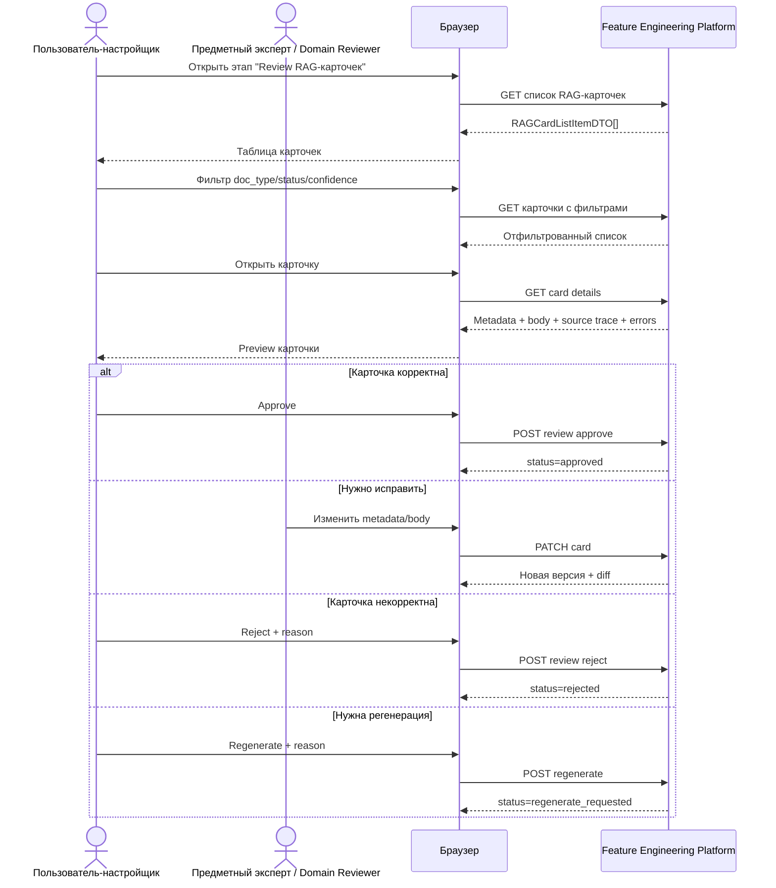
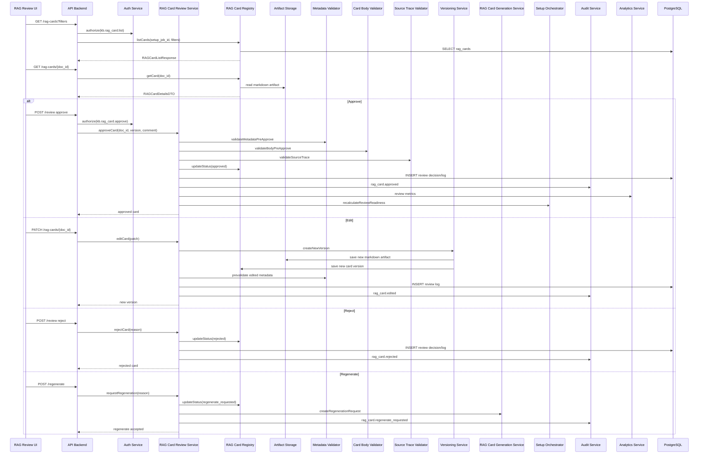

# SETUP-06. Просмотр, редактирование и подтверждение RAG-карточек

## 1. Назначение фичи

**Краткое название:** SETUP-06. Просмотр, редактирование и подтверждение RAG-карточек.

**Краткое описание:** Фича предоставляет пользователю, RAG-администратору и предметному эксперту интерфейс контроля качества автоматически созданных RAG-карточек перед их дальнейшей валидацией, чанкингом, индексацией и публикацией в Knowledge Base. Пользователь может просматривать metadata, Markdown body, source trace, validation errors, confidence level, принимать карточку, отклонять, редактировать вручную или отправлять на регенерацию.

**Какую проблему решает:** Автоматически сгенерированные RAG-карточки не должны сразу попадать в базу знаний. Даже если карточка создана LLM или rule-based генератором, в ней могут быть ошибки: неверный doc_type, неполная metadata, слабые retrieval_tags, некорректный source trace, body не отражает смысл исходной секции, LLM добавила неподтверждённые сведения, карточка дублирует другую, требует доменной проверки.

Фича решает задачу human-in-the-loop контроля:

```text
generated RAG card
  → пользовательский просмотр
  → проверка metadata/body/source/errors
  → approve / reject / edit / regenerate
  → approved RAG card
  → дальнейшая metadata validation / chunking / indexing
```

**Для какого бизнес-процесса нужна:** Фича входит в пользовательский процесс настройки RAG-базы между SETUP-05 (автоматическая генерация) и SETUP-07 (валидация metadata).

**Главный пользовательский результат:** пользователь видит список RAG-карточек, понимает качество каждой карточки, может принять/отклонить/исправить/отправить на регенерацию, а подтверждённые карточки получают статус `approved`.

---

## 2. Контекст и бизнес-цель

### 2.1. Бизнес-контекст

На входе уже существуют RAG-карточки со статусами: `generated`, `review_required`, `metadata_incomplete`, `low_confidence`, `generation_failed`, `ready_for_metadata_validation`.

Часть карточек создана уверенно и автоматически готова к следующему этапу. Другая часть требует human review из-за: низкого confidence, неполной metadata, warnings от Ontology Mapper, ошибок precheck, конфликта doc_id, пустых retrieval_tags, подозрений на дубликат, source trace mismatch, риска hallucination, доменной неоднозначности.

**Текущий pain point:** без review плохая карточка попадёт в chunks и Vector DB; downstream-агенты получат ошибочный Evidence Pack; невозможно доверять RAG без human approval; предметный эксперт не имеет интерфейса контроля; RAG-администратор не видит, какие карточки требуют вмешательства; нет журнала review-действий.

### 2.2. Бизнес-цель

KPI MVP:

| Метрика | Целевое значение MVP |
| --- | ---: |
| Доля карточек, прошедших review до chunking | 100% для `review_required` |
| Доля approved карточек без critical validation errors | ≥ 95% |
| Доля rejected карточек с указанной причиной | 100% |
| Доля edited карточек с новой версией | 100% |
| Доля review-действий с reviewer_id | 100% |
| Доля карточек без source trace среди approved | 0% |
| Доля карточек с пустым body среди approved | 0% |
| Доля approved карточек с retrieval_tags | ≥ 95% |

### 2.3. Инициатор и стейкхолдеры

**Инициатор:** Product Owner / RAG Admin / архитектор RAG-платформы.

**Заинтересованные стороны:** пользователь-настройщик, RAG-администратор, предметный эксперт, domain reviewer, ML Engineer, системный аналитик, архитектор, QA, аудитор, DevOps/MLOps.

---

## 3. Термины, определения и сокращения

| Термин | Определение |
| --- | --- |
| RAG Card | Markdown-документ с YAML metadata, body и source trace |
| RAG Review | Проверка карточки пользователем, экспертом или RAG-администратором |
| Reviewer | Пользователь, принимающий решение по карточке |
| Card Editor | UI/сервис для ручного изменения metadata или body |
| Metadata Validator | Сервис проверки YAML front matter и ontology fields |
| Validation Errors | Ошибки структуры, metadata, source trace, body |
| Review Decision | `approve`, `reject`, `edit`, `regenerate`, `request_changes` |
| Approved Card | Карточка, прошедшая review |
| Rejected Card | Карточка, исключённая из дальнейшего pipeline |
| Edited Card | Карточка, изменённая вручную |
| Regenerate Request | Команда повторно создать карточку из source section |
| Card Version | Версия RAG-карточки после генерации или ручного редактирования |
| Review Log | История действий пользователя по карточке |
| Source Trace | Связь карточки с source document и parsed section |
| Confidence Level | Оценка качества автоматической генерации: `high`, `medium`, `low` |
| Bulk Review | Подтверждение нескольких карточек одновременно |
| Diff View | Сравнение старой и новой версии карточки |
| Domain Reviewer | Предметный эксперт, отвечающий за смысл карточки |

### Статусы RAG-карточки в рамках SETUP-06

| Статус | Значение |
| --- | --- |
| `generated` | Карточка создана автоматически |
| `review_required` | Требуется human review |
| `metadata_incomplete` | Неполная metadata |
| `validation_failed` | Есть ошибки предварительной проверки |
| `editing` | Карточка редактируется |
| `edited` | Карточка изменена пользователем |
| `approved` | Карточка подтверждена |
| `rejected` | Карточка отклонена |
| `regenerate_requested` | Карточка отправлена на повторную генерацию |
| `deprecated` | Версия карточки устарела |
| `ready_for_metadata_validation` | Карточка готова к SETUP-07 |

### Решения review

| Решение | Значение |
| --- | --- |
| `approve` | Принять карточку |
| `reject` | Отклонить карточку |
| `edit` | Отредактировать карточку |
| `save_draft` | Сохранить правку как черновик |
| `submit_edit` | Сохранить правку как новую версию |
| `regenerate` | Отправить карточку на регенерацию |
| `request_changes` | Запросить изменения у другого пользователя/роли |
| `defer` | Отложить решение |

---

## 4. Границы фичи

### 4.1. In Scope

Входит в реализацию:

- отображение списка RAG-карточек;
- фильтрация по типу, статусу, confidence, source, validation errors;
- сортировка и поиск по doc_id/title/retrieval_tags;
- открытие карточки в preview;
- отображение YAML metadata, Markdown body, source trace, validation errors, warnings, confidence level, истории версий, review log;
- approve / reject / regenerate карточки;
- ручное редактирование metadata и Markdown body;
- сохранение новой версии карточки после редактирования;
- diff между версиями;
- базовая pre-validation перед approve;
- журнал review-действий и audit events;
- обновление статусов карточек;
- передача approved карточек в следующий этап;
- UI indication возможности продолжить pipeline.

Поддерживаемые типы карточек: `schema_card`, `task_card`, `analytics_card`, `field_definition_card`, `feature_pattern_card`, `validation_rule_card`, `question_template_card` (плюс `model_recommendation_card`, `ontology_card`, `relationship_card`, если включены).

### 4.2. Out of Scope

- автоматическая генерация (SETUP-05);
- полная metadata validation pipeline (SETUP-07);
- генерация chunks (SETUP-08);
- embeddings + Vector DB (SETUP-09);
- retrieval smoke tests (SETUP-10);
- публикация Knowledge Base (SETUP-11);
- совместное редактирование в реальном времени;
- multi-step approval с несколькими обязательными согласующими;
- semantic duplicate resolution;
- автоматическое исправление metadata через LLM;
- WYSIWYG-редактор Markdown;
- merge/split карточек.

### 4.3. Ограничения реализации

Технические:

- approved карточка ОБЯЗАНА иметь валидный doc_id, doc_type, source trace, непустой body, без critical validation errors;
- ручное редактирование ОБЯЗАНО создавать новую версию;
- предыдущая версия не удаляется;
- rejected карточка не передаётся в chunking;
- regenerate ОБЯЗАН создать новый generation request;
- system metadata нельзя менять без специальных прав.

Организационные (permissions): `kb.rag_card.approve`, `kb.rag_card.reject`, `kb.rag_card.edit`, `kb.rag_card.regenerate`; domain reviewer может менять body, но не все system metadata; auditor — read-only review log.

---

## 5. Пользовательские роли и внешние участники

### 5.1. Пользовательские роли

| Роль | Действия в рамках фичи |
| --- | --- |
| Пользователь-настройщик | Просматривает карточки, видит статусы и ошибки |
| RAG-администратор | Принимает, отклоняет, редактирует, отправляет на регенерацию |
| Предметный эксперт | Читает body, source trace, правит смысловые ошибки |
| Domain Reviewer | Approve/reject карточек своей области |
| ML Engineer | Проверяет analytics/feature_pattern/model cards |
| Системный аналитик | Проверяет task/schema/question cards |
| Аудитор | Читает review log и версии |
| Администратор проекта | Admin override |

### 5.2. Внешние участники

| Участник | Тип | Роль | Интерфейс |
| --- | --- | --- | --- |
| Локальная LLM / Ollama | Внешняя система | Используется при regenerate через SETUP-05 | API |
| Object Storage | Инфраструктура | Хранит Markdown artifacts и версии | API |
| Identity Provider | Внешняя система | Авторизация и роли | OAuth/OIDC/API |

### 5.3. Права доступа

Необходимые permissions / scopes:

- `kb.rag_card.list`
- `kb.rag_card.read`
- `kb.rag_card.preview`
- `kb.rag_card.edit`
- `kb.rag_card.approve`
- `kb.rag_card.reject`
- `kb.rag_card.regenerate`
- `kb.rag_card.version.read`
- `kb.rag_card.diff.read`
- `kb.rag_card.review_log.read`
- `kb.rag_card.validation.read`
- `kb.rag_card.source_trace.read`

Ограничения: пользователь без edit permission не видит кнопку сохранения правки; auditor не может менять статус; approved карточка изменяется только через новую версию и повторный review; published карточка не редактируется напрямую.

---

## 6. Сервисы и системы-участники

### 6.1. Внутренние сервисы

| Сервис | Роль | Тип взаимодействия |
| --- | --- | --- |
| RAG Review UI | UI просмотра, фильтрации, редактирования, подтверждения | sync + async status |
| API Backend | REST API для list, preview, review, edit, regenerate | sync |
| Auth Service | Проверка прав доступа | sync |
| RAG Card Registry | Источник истины по карточкам, статусам, версиям | sync |
| RAG Card Review Service | Бизнес-логика approve/reject/edit/regenerate | sync/async |
| Card Editor Service | Применение изменений metadata/body, новая версия | sync |
| Metadata Validator | Pre-approve validation, edit validation | sync |
| Card Body Validator | Проверка Markdown body | sync |
| Source Trace Validator | Проверка связи с source document/section | sync |
| Versioning Service | Создание новых версий карточки | sync |
| Artifact Storage Service | Сохранение Markdown artifacts и snapshots | sync |
| RAG Card Generation Service | Получает regenerate requests (SETUP-05) | async |
| Setup Orchestrator | Определяет переход к следующему этапу | async/sync |
| Notification Service | Уведомления о review events | async |
| Audit Service | Пишет review audit trail | async |
| Analytics Service | Хранит метрики review | async |

### 6.2. Внешние системы

| Система | Назначение | Канал | Критичность |
| --- | --- | --- | --- |
| Object Storage | Markdown artifacts, version snapshots | API | High |
| PostgreSQL | Карточки, версии, review logs | SQL | High |
| Redis | Кэш списка, locks на редактирование | API | Medium |
| Kafka / Event Bus | Review events, status changes | Event | Medium |
| ClickHouse | Аналитика review | SQL/Event ingest | Medium |
| LLM / Ollama | Используется только при regenerate через SETUP-05 | API | Medium |

### 6.3. Хранилища и инфраструктура

PostgreSQL: `rag_cards`, `rag_card_metadata`, `rag_card_versions`, `rag_card_artifacts`, `rag_card_review_requests`, `rag_card_review_decisions`, `rag_card_review_logs`, `rag_card_validation_reports`, `rag_card_edit_locks`, `rag_card_source_links`, `rag_card_status_history`.

Object Storage: `rag/cards/{setup_job_id}/{doc_id}/{version}.md`, `*.metadata.json`, `*.diff.json`, `*.review_report.json`.

Redis: `rag_card_edit_lock:{doc_id}`, `rag_card_review_list_cache:{setup_job_id}`, `rag_card_preview_cache:{doc_id}:{version}`.

Kafka / Event Bus: `rag_card.review_requested`, `rag_card.approved`, `rag_card.rejected`, `rag_card.edited`, `rag_card.regenerate_requested`, `rag_card.version_created`, `rag_card.review_completed`.

ClickHouse: `rag_card_review_events`, `rag_card_review_duration_metrics`, `rag_card_status_transition_metrics`, `rag_card_quality_metrics`.

---

## 7. Пользовательские сценарии

### 7.1. Основной happy path

Предусловия: пользователь авторизован, существует setup job, SETUP-05 завершён полностью или частично, есть RAG-карточки со статусом `generated`/`review_required`/`metadata_incomplete`/`validation_failed`, пользователь имеет право просмотра, RAG Card Registry и Artifact Storage доступны.

Триггер: пользователь открывает этап "Просмотр и подтверждение RAG-карточек" или system переводит workflow в этот этап.

Шаги:

1. Пользователь открывает список RAG-карточек.
2. Frontend запрашивает список по `setup_job_id`.
3. Система возвращает карточки с краткими metadata: `doc_id`, `title`, `doc_type`, `status`, `confidence_level`, `source_document`, `validation_errors_count`, `review_required_reason`.
4. Пользователь фильтрует по `doc_type`, `status`, `confidence_level`, `source_document`, `validation_errors`.
5. Пользователь открывает карточку.
6. UI показывает YAML metadata, Markdown body preview, source trace, validation errors, warnings, confidence level, version history, review log.
7. Пользователь проверяет карточку.
8. Если карточка корректна, нажимает "Принять".
9. Система выполняет pre-approve checks: doc_id exists, doc_type valid, source trace exists, body not empty, no critical validation errors.
10. Система создаёт `ReviewDecisionDTO`.
11. RAG Card Registry меняет статус: `review_required/generated → approved`.
12. Audit Service фиксирует действие.
13. UI обновляет список карточек.
14. Если все обязательные карточки review завершили, Setup Orchestrator разрешает переход к SETUP-07.

### 7.2. Альтернативные сценарии

**A1. Edit metadata** — пользователь открывает вкладку Metadata, нажимает "Редактировать", меняет `title`/`retrieval_tags`/`phase`/`agent_targets`/`domain`/`task_type`/`data_source`/`entity_type`. Система валидирует. Versioning Service создаёт новую версию. Статус: `edited`. После approve: `edited → approved`.

**A2. Edit Markdown body** — пользователь редактирует body, видит preview, Card Body Validator проверяет непустоту, создаётся новая версия, review log фиксирует изменение.

**A3. Reject** — пользователь нажимает "Отклонить", выбирает reason (`duplicate`, `wrong_doc_type`, `incorrect_content`, `irrelevant`, `hallucination`, `source_mismatch`, `other`). Статус: `rejected`. Карточка исключается из downstream pipeline.

**A4. Regenerate** — пользователь нажимает "Регенерировать", указывает reason. Система создаёт `RegenerateRAGCardRequest`. Статус: `regenerate_requested`. SETUP-05 запускается для связанной source section.

**A5. Карточка с critical validation errors** — approve запрещён. Доступны: edit / regenerate / reject.

**A6. Warnings без critical errors** — approve разрешён с показом предупреждения. Решение фиксируется в review log.

**A7. Bulk approve** — если включён feature flag `enable_bulk_approve`, пользователь выбирает несколько карточек без critical errors и нажимает "Принять выбранные". Bulk approve запрещён для `validation_failed`/`metadata_incomplete`/`low_confidence` при strict policy.

**A8. Edit lock active** — UI показывает "Карточка редактируется пользователем X". Доступен read-only preview.

### 7.3. Негативные сценарии

| Код | Сценарий |
| --- | --- |
| N1 | Нет карточек для review — empty state |
| N2 | Карточка не найдена — `RAG_CARD_NOT_FOUND` |
| N3 | Нет прав на approve — кнопка скрыта/disabled |
| N4 | Approve с critical errors — `CARD_HAS_CRITICAL_VALIDATION_ERRORS` |
| N5 | Source trace отсутствует — `SOURCE_TRACE_REQUIRED` |
| N6 | Сохранение версии не удалось — `CARD_VERSION_SAVE_FAILED` |
| N7 | Artifact Storage недоступен — body unavailable |
| N8 | Version conflict — `CARD_VERSION_CONFLICT` |
| N9 | Repeated approve — идемпотентен, возвращает текущий approved state |
| N10 | Regenerate недоступен — pending/failed |

### 7.4. Постусловия

После успешного review создаются: `ReviewDecisionDTO`, `ReviewLog entry`; карточка получает новый статус; при edit — новая версия; при approve — `approved`; при reject — исключение из downstream; при regenerate — новый regeneration request; audit/analytics events публикуются; UI обновляет список; Setup Orchestrator пересчитывает readiness следующего этапа.

Создаются/обновляются: `rag_card_review_decisions`, `rag_card_review_logs`, `rag_card_versions`, `rag_card_status_history`, `rag_card_validation_reports`, `rag_card_artifacts`, `audit_events`, `analytics_events`, `notification_events`.

Публикуются события: `rag_card.review_started`, `rag_card.approved`, `rag_card.rejected`, `rag_card.edited`, `rag_card.regenerate_requested`, `rag_card.version_created`, `rag_card.review_completed`.

---

## 8. Диаграмма последовательности: система и внешние участники



---

## 9. Диаграмма последовательности: взаимодействие сервисов



Идемпотентность: `approve`/`reject` идемпотентны по `review_decision_id`; `edit` проверяет `expected_version`; `regenerate` идемпотентен по `regenerate_request_id`. Event publication — через outbox.

---

## 10. Frontend Scope

### 10.1. UI компоненты

```text
KnowledgeBaseSetupPage
  └ RAGCardReviewStep
    ├ RAGCardReviewTable
    ├ RAGCardFiltersPanel
    ├ RAGCardPreviewDrawer
    │   ├ RAGCardMetadataViewer / Editor
    │   ├ RAGCardMarkdownViewer / Editor
    │   ├ RAGCardSourceTracePanel
    │   ├ RAGCardValidationErrorsPanel
    │   ├ RAGCardVersionHistory
    │   ├ RAGCardDiffView
    │   └ ReviewLogPanel
    ├ ReviewDecisionDialog
    ├ RejectReasonDialog
    ├ RegenerateReasonDialog
    ├ BulkReviewToolbar
    └ ReviewProgressSummary
```

**RAGCardReviewTable колонки:** doc_id, title, doc_type, status, confidence_level, validation_errors_count, source_document, source_section, version, reviewer, updated_at, actions.

**Фильтры:** doc_type, status, confidence_level, source_document, has_validation_errors, review_required, reviewer, updated_at.

**RAGCardPreviewDrawer вкладки:** Overview, Metadata, Body, Source Trace, Validation, Versions, Review Log, Diff.

**RAGCardMetadataEditor editable fields:** title, domain, task_type, data_source, entity_type, phase, agent_targets, retrieval_tags, required_input_fields, output_fields, feature_tables, validation_rules, compatible_models.

**Read-only fields:** doc_id (если карточка уже создана), source_files, source_sections, created_by, created_at, published_at, system_metadata.

### 10.2. Клиентская логика

Валидации: approve disabled при critical errors / missing source trace / empty body; reject reason required; regenerate reason required; edit save disabled при invalid metadata; нельзя сохранить при version conflict; нельзя bulk approve карточки с critical errors.

Управление состоянием: `cardsList`, `filters`, `pagination`, `selectedCard`, `cardDetails`, `cardMetadataDraft`, `cardBodyDraft`, `validationErrors`, `versionHistory`, `reviewLog`, `diffState`, `editLockState`, `reviewDecisionState`, `bulkSelectionState`, `permissions`, `loadingStates`, `errorStates`.

Feature flags: `enable_card_manual_edit`, `enable_metadata_editor`, `enable_markdown_editor`, `enable_bulk_approve`, `enable_card_regenerate`, `enable_card_diff_view`, `enable_review_comments`, `enable_domain_reviewer_assignment`, `enable_multi_step_approval`.

### 10.3. UX требования

- быстро видеть количество карточек, требующих review;
- проблемные карточки визуально выделены;
- открытие без запуска тяжёлых процессов;
- metadata и body разделены;
- source trace легко доступен;
- validation errors объяснены человеческим языком;
- approve/reject/regenerate требуют подтверждения;
- reject/regenerate требуют причины;
- edit показывает diff;
- approved карточка исчезает из фильтра `review_required`;
- empty state объясняет состояние;
- read-only режим для auditor;
- состояние review восстанавливается после refresh.

---

## 11. Backend Scope

### 11.1. Изменения в сервисах

**API Backend** — добавить handlers:

```text
GET   /api/setup/{setup_job_id}/rag-cards
GET   /api/setup/{setup_job_id}/rag-cards/{doc_id}
GET   /api/setup/{setup_job_id}/rag-cards/{doc_id}/versions
GET   /api/setup/{setup_job_id}/rag-cards/{doc_id}/diff
GET   /api/setup/{setup_job_id}/rag-cards/{doc_id}/review-log
POST  /api/setup/{setup_job_id}/rag-cards/{doc_id}/review
PATCH /api/setup/{setup_job_id}/rag-cards/{doc_id}
POST  /api/setup/{setup_job_id}/rag-cards/{doc_id}/regenerate
POST  /api/setup/{setup_job_id}/rag-cards/bulk-review
```

**RAG Card Review Service use cases:** list_review_cards, get_card_for_review, approve_card, reject_card, edit_card, save_card_draft, submit_card_edit, request_regeneration, bulk_approve_cards, get_review_log, get_card_diff, calculate_review_readiness.

**RAG Card Registry:** status transitions, card version lookup, list filters, review status counters, locking info, status history.

**Card Editor Service:** validate editable fields, normalize metadata patch, apply body patch, create new version payload, calculate diff.

**Versioning Service:** create_card_version, compare_versions, mark_previous_version_deprecated_if_policy, store_version_snapshot.

**Setup Orchestrator:** recalculate_review_readiness, block next step if required reviews remain, allow transition to SETUP-07 if all blocking cards approved/rejected/resolved.

### 11.2. Изменения в данных

Новые/расширяемые таблицы (in-memory MVP, PostgreSQL design):

- `rag_card_review_decisions` (review_decision_id, setup_job_id, doc_id, card_version, decision, reason, comment, reviewer_id, reviewer_role, created_at, metadata_json) — индексы: doc_id, setup_job_id, reviewer_id, decision; unique(review_decision_id).
- `rag_card_review_logs` (review_log_id, setup_job_id, doc_id, card_version, event_type, actor_id, actor_role, message, before_status, after_status, created_at, payload_json) — индексы: doc_id, setup_job_id, created_at.
- `rag_card_versions` (doc_id, card_version, parent_card_version, status, markdown_artifact_id, metadata_snapshot_json, body_hash, created_by, created_at, change_reason, is_current) — unique(doc_id, card_version).
- `rag_card_edit_locks` (lock_id, doc_id, card_version, locked_by, locked_at, expires_at, status).

### 11.3. Интеграции

- SETUP-07 принимает только `approved`/`ready_for_metadata_validation`;
- SETUP-08 не принимает `rejected`/`review_required`;
- SETUP-05 принимает regenerate requests из SETUP-06;
- Audit Trail включает review decisions.

---

## 12. Бизнес-правила и ограничения

### Правила принятия решения

- Карточка может быть `approved` только при наличии `doc_id`, `doc_type`, source trace и body.
- Карточка с critical validation errors не может быть `approved`.
- Карточка с warnings может быть approved, если policy разрешает.
- Карточка с missing source trace не может быть approved.
- Rejected карточка не участвует в downstream pipeline.
- Edited карточка должна создать новую версию.
- Regenerate создаёт запрос в SETUP-05, а не меняет карточку напрямую.
- Published карточка не редактируется в рамках SETUP-06.
- Решение review должно иметь `reviewer_id`.
- Reject и regenerate требуют `reason`.

**Что проверяет человек на этом шаге** ([ADR-HTC-10](../../03-architecture/adr/ADR-HTC-10-classification-hints-single-source.md)). Смысл карточки: соответствует ли содержание исходной секции и верно ли определены тип карточки и онтологические поля. Эти поля выводятся детерминированно из классификации шага 3 (хинты узлов дерева SETUP-13), поэтому ревьюер видит путь классификации и узел-источник каждого значения (вкладка Source Trace). Правка значения в карточке — локальная (новая версия карточки). Если одно и то же значение неверно у многих карточек одной ветки, исправлять надо хинт на узле дерева (SETUP-13) и повторять генерацию, а не править карточки по одной. Структурную и онтологическую проверку выполняют precheck шага 4 и SETUP-07; ревью их не заменяет.

### Допустимые переходы статусов

```text
generated, review_required, metadata_incomplete, validation_failed
  → approved | rejected | edited | regenerate_requested

edited → approved | rejected | regenerate_requested

approved → edited (только через новую версию и повторный review)
approved → deprecated (только через versioning/admin process)

rejected → regenerate_requested (по policy)
rejected → approved (запрещён без новой версии)
```

### Ограничения по ролям

- `approve` доступен только `kb.rag_card.approve`;
- `reject` — `kb.rag_card.reject`;
- `edit` — `kb.rag_card.edit`;
- `regenerate` — `kb.rag_card.regenerate`;
- bulk approve — только RAG admin;
- auditor read-only;
- domain reviewer может approve только карточки своего domain/entity_type (если включена domain policy).

### Идемпотентность

- `review_decision_id` предотвращает повторное применение approve/reject;
- `regenerate_request_id` предотвращает дубли regeneration jobs;
- `edit` использует `expected_version`;
- repeated approve по уже approved карточке возвращает current state.

---

## 13. Входные данные и источники

### 13.1. Входные данные

| Поле | Тип | Обязательность | Источник | Правила валидации |
| --- | --- | --- | --- | --- |
| `setup_job_id` | string | Required | URL/API | Должен существовать |
| `doc_id` | string | Required | URL/API | Карточка должна существовать |
| `card_version` | string | Required для edit/review | API/UI | Должна быть текущей |
| `review_decision_id` | string | Recommended | UI/API | Для идемпотентности |
| `decision` | string | Required | UI | approve/reject/edit/regenerate |
| `reason` | string | Required для reject/regenerate | UI | Не пустой |
| `comment` | string | Optional | UI | Лимит длины |
| `metadata_patch` | object | Optional для edit | UI | Только editable fields |
| `body_markdown` | string | Optional для edit | UI | Не пустой при submit |
| `expected_version` | string | Required для edit | UI/API | Optimistic concurrency |
| `validation_errors` | list | Read-only | Validator | Показываются в UI |
| `confidence_level` | string | Read-only | Registry | high/medium/low |
| `source_links` | list | Read-only | Source Registry | Должны существовать для approve |
| `reviewer_id` | string | System | Auth | Из user context |
| `reviewer_role` | string | System | Auth | Из user context |

### 13.2. Источники данных

RAG Card Registry; RAG Card Metadata; Markdown artifact; Source Registry; Parsed Section Registry; Validation Reports; User input; Auth; Versioning Service; Artifact Storage; Setup Orchestrator state; configuration / review policy.

### 13.3. Предварительные проверки

Обязательности: `setup_job_id` существует; `doc_id` существует; `card_version` существует; пользователь авторизован; `action` разрешён текущим статусом; для reject/regenerate указан `reason`; для edit есть изменения.

Форматные: `metadata_patch` соответствует schema editable fields; `body_markdown` не пустой; `retrieval_tags` не пустые при редактировании; `phase`/`agent_targets` в allowed enum; comment/reason не превышают лимиты.

Существование: `source_document_id`/`source_section_id` существуют; `markdown_artifact_id` доступен; `current_version` совпадает с `expected_version`.

---

## 14. Выходные данные и результаты

### 14.1. Ответы клиенту

**Список карточек** (`RAGCardReviewListResponse`):

```json
{
  "setup_job_id": "setup_001",
  "items": [
    {
      "doc_id": "analytics.sensor_analytics_T.v1",
      "title": "Sensor analytics feature table",
      "doc_type": "analytics_card",
      "status": "review_required",
      "confidence_level": "medium",
      "card_version": "1.0",
      "source_document_id": "src_001",
      "source_section_id": "sec_005",
      "validation_errors_count": 0,
      "warnings_count": 2,
      "review_required_reason": "Medium confidence metadata"
    }
  ],
  "summary": {
    "total": 22,
    "approved": 10,
    "review_required": 5,
    "rejected": 2,
    "validation_failed": 3,
    "edited": 2
  }
}
```

**Approve response:**

```json
{
  "doc_id": "...",
  "card_version": "1.0",
  "status": "approved",
  "review_decision_id": "review_decision_001",
  "reviewed_by": "user_001",
  "reviewed_at": "2026-06-19T12:00:00Z"
}
```

**Edit response:**

```json
{
  "doc_id": "...",
  "previous_version": "1.0",
  "new_version": "1.1",
  "status": "edited",
  "markdown_artifact_id": "artifact_card_1_1",
  "diff_available": true
}
```

### 14.2. Побочные эффекты

Создаются: `rag_card_review_decisions`, `rag_card_review_logs`, `rag_card_status_history`, `rag_card_versions`, `rag_card_artifacts`, `rag_card_validation_reports`, `audit_events`, `analytics_events`, `notification_events`.

Публикуются события: `rag_card.approved`, `rag_card.rejected`, `rag_card.edited`, `rag_card.regenerate_requested`, `rag_card.version_created`, `rag_card.review_completed`, `setup.review_readiness_changed`.

### 14.3. Результирующее состояние

- **approve:** `RAGCard.status = approved`, ReviewDecision created, ReviewLog updated, Setup readiness recalculated.
- **reject:** `RAGCard.status = rejected`, card excluded from downstream, reason saved.
- **edit:** new `card_version` created, status = `edited` или `review_required` по policy, old version preserved, diff created.
- **regenerate:** `RAGCard.status = regenerate_requested`, Regeneration request created, SETUP-05 triggered.

---

## 15. DTO и модели данных

### 15.1. Входные DTO

**`ReviewRAGCardRequest`** — `review_decision_id`, `doc_id`, `card_version`, `decision` ("approve"|"reject"|"edit"|"regenerate"), `reason` (optional), `comment` (optional).

**`RejectRAGCardRequest`** — расширение `ReviewRAGCardRequest` с обязательным `reason`.

**`EditRAGCardRequest`** — `doc_id`, `expected_version`, `metadata_patch` (object), `body_markdown` (string), `change_reason`.

**`RegenerateRAGCardRequest`** — `regenerate_request_id`, `doc_id`, `card_version`, `reason`, `instruction` (optional).

**`BulkReviewRequest`** — `bulk_review_id`, `decision`, `items[]` (doc_id+card_version), `comment`.

### 15.2. Выходные DTO

**`RAGCardReviewListItemDTO`** — `doc_id`, `card_version`, `title`, `doc_type`, `status`, `confidence_level`, `source_document_id`, `source_section_id`, `validation_errors_count`, `warnings_count`, `review_required_reason`, `last_reviewed_by`, `updated_at`.

**`RAGCardReviewDetailsDTO`** — `doc_id`, `card_version`, `title`, `doc_type`, `status`, `confidence_level`, `metadata` (object), `body_markdown`, `source_trace` (object), `validation` (critical_errors + warnings), `permissions` (can_approve/can_reject/can_edit/can_regenerate).

**`ReviewDecisionDTO`** — `review_decision_id`, `setup_job_id`, `doc_id`, `card_version`, `decision`, `reason`, `comment`, `reviewer_id`, `reviewer_role`, `created_at`.

**`RAGCardVersionDTO`** — `doc_id`, `card_version`, `parent_card_version`, `status`, `markdown_artifact_id`, `metadata_snapshot`, `body_hash`, `created_by`, `created_at`, `change_reason`.

**`RAGCardDiffDTO`** — `doc_id`, `from_version`, `to_version`, `metadata_diff[]` (field/old_value/new_value), `body_diff` (format: unified, content).

### 15.3. Доменные сущности

`RAGCardReviewDecision`, `RAGCardReviewLog`, `RAGCardVersion`, `RAGCardEditLock`, `RAGCardValidationSnapshot`.

Связи: `RAGCard 1 → N RAGCardVersion`; `RAGCardVersion 1 → N ReviewDecision`; `RAGCardVersion 1 → N ReviewLog`; `RAGCardVersion 1 → 1 MarkdownArtifact`; `RAGCard 1 → N SourceLinks`; `RAGCard 1 → N RegenerationRequest`.

### 15.4. Версионирование

- Manual edit создаёт новую `card_version`;
- Regenerate создаёт новую `card_version` после SETUP-05;
- Approved version фиксируется как текущая для downstream;
- Old versions сохраняются для audit;
- Published version immutable.

---

## 16. API contracts / event contracts

### 16.1. REST API

| Метод | URL | Назначение |
| --- | --- | --- |
| GET | `/api/setup/{setup_job_id}/rag-cards` | Список карточек с фильтрами |
| GET | `/api/setup/{setup_job_id}/rag-cards/{doc_id}` | Details карточки |
| GET | `/api/setup/{setup_job_id}/rag-cards/{doc_id}/versions` | История версий |
| GET | `/api/setup/{setup_job_id}/rag-cards/{doc_id}/diff` | Сравнение версий |
| POST | `/api/setup/{setup_job_id}/rag-cards/{doc_id}/review` | Approve/reject |
| PATCH | `/api/setup/{setup_job_id}/rag-cards/{doc_id}` | Edit metadata/body |
| POST | `/api/setup/{setup_job_id}/rag-cards/{doc_id}/regenerate` | Запрос регенерации |
| GET | `/api/setup/{setup_job_id}/rag-cards/{doc_id}/review-log` | Журнал review |
| POST | `/api/setup/{setup_job_id}/rag-cards/bulk-review` | Bulk решение |

Status codes: 200/201 OK, 400 Bad Request, 403 Forbidden, 404 Not Found, 409 Conflict (version conflict/invalid status transition), 422 Unprocessable Entity (critical errors), 500.

### 16.2. События

| Событие | Producer | Consumer | Payload | Доставка |
| --- | --- | --- | --- | --- |
| `rag_card.review_started` | Review Service | Analytics | doc_id + reviewer | at-least-once |
| `rag_card.approved` | Review Service | Orchestrator, Audit, Analytics | ReviewDecisionDTO | at-least-once |
| `rag_card.rejected` | Review Service | Orchestrator, Audit, Analytics | ReviewDecisionDTO | at-least-once |
| `rag_card.edited` | Card Editor | Audit, Analytics, Registry | RAGCardVersionDTO | at-least-once |
| `rag_card.version_created` | Versioning | Registry, Audit | RAGCardVersionDTO | at-least-once |
| `rag_card.regenerate_requested` | Review Service | RAG Card Generator, Orchestrator | RegenerateRAGCardRequest | at-least-once |
| `rag_card.review_completed` | Review Service | Orchestrator, Notification | review summary | at-least-once |
| `setup.review_readiness_changed` | Setup Orchestrator | Frontend, Analytics | readiness summary | at-least-once |

### 16.3. Контрактные требования

Идемпотентность: `review_decision_id`, `regenerate_request_id`, `expected_version`.

Таймауты: list cards — быстрый pagination; preview — отдельный timeout на artifact read; approve/reject — синхронные короткие; regenerate — async.

Ретраи: event publication через outbox; artifact read retry; version save retry только при идемпотентном request.

Backward compatibility: новые optional fields допустимы; новые decisions требуют UI fallback; event consumers игнорируют unknown fields.

---

## 17. Нефункциональные требования

**Производительность:** pagination списка; индексы по setup_job_id/status/doc_type; быстрое открытие карточки; diff по двум версиям без полного сканирования; bulk actions batch с per-card result.

**Доступность:** read-only просмотр работает при недоступности regenerate; metadata доступна даже при недоступности Artifact Storage; review decisions не теряются при сбое event bus.

**Масштабируемость:** большое число карточек в setup job; индексы по setup_job_id/status/doc_type; version history paginated; review log paginated; editor locks через Redis или DB.

**Безопасность:** строгая проверка permissions; защита от HTML/script injection в Markdown preview; безопасный Markdown renderer; запрет edit system metadata без admin rights; audit всех review/edit действий; source trace не раскрывает документы без доступа; regenerate не отправляет restricted content во внешние LLM.

**Аудит:** кто просмотрел/принял/отклонил/изменил карточку, что изменилось, какая версия была утверждена, почему карточка отклонена.

**Наблюдаемость — метрики:** `rag_card_reviews_total`, `rag_card_approved_total`, `rag_card_rejected_total`, `rag_card_edited_total`, `rag_card_regenerate_requested_total`, `rag_card_review_duration_ms`, `rag_card_validation_blocked_approve_total`, `rag_card_version_conflicts_total`, `rag_card_review_by_doc_type`.

**Логи:** setup_job_id, doc_id, card_version, reviewer_id, decision, reason, status_before, status_after, duration_ms, error_code.

**Лимиты:** max_cards_per_page, max_bulk_review_size, max_body_markdown_size, max_metadata_patch_size, max_review_comment_length, edit_lock_ttl.

---

## 18. Ошибки и обработка исключений

### 18.1. Validation errors

| Код | HTTP | Описание |
| --- | ---: | --- |
| `RAG_CARD_NOT_FOUND` | 404 | Карточка не найдена |
| `CARD_VERSION_NOT_FOUND` | 404 | Версия карточки не найдена |
| `INSUFFICIENT_PERMISSIONS` | 403 | Нет прав |
| `INVALID_REVIEW_DECISION` | 400 | Некорректное решение |
| `REJECT_REASON_REQUIRED` | 400 | Для reject нужна причина |
| `REGENERATE_REASON_REQUIRED` | 400 | Для regenerate нужна причина |
| `CARD_HAS_CRITICAL_VALIDATION_ERRORS` | 422 | Approve запрещён |
| `SOURCE_TRACE_REQUIRED` | 422 | Нет source trace |
| `CARD_BODY_EMPTY` | 422 | Body пустой |
| `INVALID_METADATA_PATCH` | 400 | Невалидная metadata правка |
| `SYSTEM_METADATA_READ_ONLY` | 400 | Попытка изменить system metadata |
| `CARD_VERSION_CONFLICT` | 409 | Редактирование неактуальной версии |
| `INVALID_STATUS_TRANSITION` | 409 | Недопустимый переход статуса |
| `EDIT_LOCK_ACTIVE` | 409 | Карточка редактируется другим пользователем |

### 18.2. Системные ошибки

`RAG_CARD_REGISTRY_UNAVAILABLE` (503/retry), `ARTIFACT_STORAGE_UNAVAILABLE` (metadata-only fallback), `VERSIONING_SERVICE_FAILED` (rollback), `METADATA_VALIDATOR_UNAVAILABLE` (block approve/warning), `SOURCE_TRACE_VALIDATOR_FAILED` (block approve), `AUDIT_EVENT_WRITE_FAILED` (outbox), `EVENT_BUS_UNAVAILABLE` (outbox), `SETUP_ORCHESTRATOR_UNAVAILABLE` (retry async).

### 18.3. Поведение

**Ретраи:** artifact read retry; event publish через outbox; regenerate retry; readiness recalculation retry; audit event retry.

**Compensation:** orphaned artifact handling при partial save; status update rollback при failed log persist.

**DLQ:** approved/rejected/edited events; regenerate requests; readiness recalculation events.

**Ручная обработка:** RAG admin может снять edit lock; admin override rejected/approved policy; auditor может выгрузить review log.

---

## 19. Acceptance Criteria

### Просмотр списка

- **AC-01:** Пользователь с `kb.rag_card.list` может открыть список RAG-карточек setup job.
- **AC-02:** Список поддерживает фильтр по `doc_type`.
- **AC-03:** Список поддерживает фильтр по `status`.
- **AC-04:** Список поддерживает фильтр по `confidence_level`.
- **AC-05:** Список показывает `validation_errors_count` и `warnings_count`.
- **AC-06:** Список поддерживает pagination.

### Просмотр карточки

- **AC-07:** Пользователь с `kb.rag_card.read` может открыть карточку.
- **AC-08:** Отображается YAML metadata.
- **AC-09:** Отображается Markdown body preview.
- **AC-10:** Отображается source document и source section.
- **AC-11:** Отображаются validation errors и warnings.
- **AC-12:** Отображается confidence level.
- **AC-13:** Отображается version history.
- **AC-14:** Отображается review log.

### Approve

- **AC-15:** Пользователь с `kb.rag_card.approve` может принять карточку без critical errors.
- **AC-16:** Карточка без source trace не может быть approved.
- **AC-17:** Карточка с пустым body не может быть approved.
- **AC-18:** При approve создаётся `ReviewDecisionDTO`.
- **AC-19:** При approve создаётся запись в review log.
- **AC-20:** Статус карточки меняется на `approved`.
- **AC-21:** Повторный approve с тем же `review_decision_id` идемпотентен.

### Reject

- **AC-22:** Пользователь с `kb.rag_card.reject` может отклонить карточку.
- **AC-23:** Reject требует `reason`.
- **AC-24:** Статус меняется на `rejected`.
- **AC-25:** Rejected карточка не передаётся в downstream pipeline.
- **AC-26:** Причина reject сохраняется в review log.

### Edit

- **AC-27:** Пользователь с `kb.rag_card.edit` может редактировать разрешённые metadata fields.
- **AC-28:** Пользователь может редактировать Markdown body.
- **AC-29:** Попытка изменить system metadata отклоняется.
- **AC-30:** Редактирование создаёт новую `card_version`.
- **AC-31:** Старая версия сохраняется.
- **AC-32:** После редактирования доступен diff.
- **AC-33:** Edit с устаревшей `expected_version` возвращает conflict.

### Regenerate

- **AC-34:** Пользователь с `kb.rag_card.regenerate` может отправить карточку на регенерацию.
- **AC-35:** Regenerate требует `reason`.
- **AC-36:** Создаётся `RegenerateRAGCardRequest`.
- **AC-37:** Статус меняется на `regenerate_requested`.
- **AC-38:** Regenerate request передаётся в SETUP-05.

### Readiness

- **AC-39:** Setup Orchestrator пересчитывает readiness после каждого review decision.
- **AC-40:** Переход к SETUP-07 разрешён, если все blocking карточки обработаны.
- **AC-41:** Rejected карточки исключаются из дальнейшего pipeline.
- **AC-42:** `review_required` карточки блокируют переход к chunking.

### Audit / Analytics

- **AC-43:** Каждое review decision пишет audit event.
- **AC-44:** Каждое редактирование пишет audit event.
- **AC-45:** Каждая новая версия карточки фиксируется.
- **AC-46:** Review metrics отправляются в Analytics Service.

---

## 20. Definition of Done

- RAG Review UI реализован (ReviewCardsStep + всё дерево компонентов).
- Фильтры по doc_type/status/confidence работают.
- Preview Drawer с 8 вкладками реализован.
- Metadata/Markdown editor (если в MVP).
- Review decision dialogs с required reason для reject/regenerate.
- Diff view + version history.
- API list/get/review/edit/regenerate реализованы.
- RAG Card Review Service rewrite готов.
- Card Editor Service + Versioning Service.
- Pre-approve validators подключены (metadata + body + source trace).
- Status transition rules реализованы.
- In-memory repositories (snapshot persistence).
- Audit events и analytics events пишутся.
- Setup Orchestrator readiness пересчитывается.
- Unit / integration / contract / E2E / negative tests зелёные.
- Документация API обновлена.
- DTO catalog обновлён.
- Security review Markdown preview/edit выполнен.
- Monitoring metrics добавлены.

---

## 21. Тесты

### 21.1. Unit tests

`test_approve_card_success`, `test_approve_card_fails_without_source_trace`, `test_approve_card_fails_with_empty_body`, `test_reject_requires_reason`, `test_regenerate_requires_reason`, `test_edit_creates_new_card_version`, `test_edit_rejects_system_metadata_change`, `test_review_decision_is_idempotent`, `test_version_conflict_detected`, `test_status_transitions`, `test_diff_generation`, `test_review_log_mapping`.

### 21.2. Integration tests

`test_review_approve_updates_status_and_logs_decision`, `test_review_reject_excludes_card_from_pipeline`, `test_edit_card_saves_new_markdown_artifact`, `test_regenerate_request_published_to_generator`, `test_approved_card_allows_next_stage_readiness`.

### 21.3. Contract tests

OpenAPI для всех 9 endpoints; event schema для всех 8 событий; backward compatibility ReviewDecisionDTO.

### 21.4. E2E / UI tests

Happy path approve, edit path с diff, reject path с reason, regenerate path.

### 21.5. Negative / resilience

approve без прав / с critical errors; reject без reason; regenerate без reason; edit version conflict; artifact storage unavailable; registry unavailable; event bus unavailable; repeated approve; edit lock active; stale edit lock cleanup.

---

## 22. Риски, допущения и открытые вопросы

### 22.1. Риски

| Риск | Влияние | Митигация |
| --- | --- | --- |
| Пользователь примет некачественную карточку | Высокое | pre-approve validation, warnings, role permissions |
| Пользователь испортит metadata | Высокое | editable fields policy, validation, versioning |
| Markdown preview XSS-риск | Высокое | безопасный renderer, sanitizer |
| Review станет узким местом | Среднее | фильтры, bulk approve, focus on review_required |
| Версионные конфликты при редактировании | Среднее | expected_version, edit locks |
| Аудит лог неполный | Высокое | mandatory audit events, transaction/outbox |
| Source trace missing блокирует много карточек | Среднее | return to SETUP-05/SETUP-03 repair |
| Regenerate создаёт ещё хуже карточку | Среднее | versioning, compare, review again |

### 22.2. Допущения

- SETUP-05 уже создаёт RAGCardDTO.
- Карточки имеют doc_id, doc_type, status, confidence_level.
- Карточки связаны с source_document_id и source_section_id.
- Markdown artifacts доступны через Artifact Storage.
- Metadata validation errors / precheck reports доступны.
- Permissions определены.
- В MVP достаточно single reviewer.
- Multi-approval workflow отложена.
- Approved карточка пройдёт SETUP-07.

### 22.3. Открытые вопросы

| Вопрос | Ответственный |
| --- | --- |
| Какие поля metadata доступны для ручного редактирования в MVP? | RAG Architect / Product Owner |
| Можно ли approve карточку с warnings? | RAG Admin / Product Owner |
| Нужен ли bulk approve в MVP? | Product Owner |
| Какой набор reject reasons использовать? | RAG Admin / System Analyst |
| Должен ли domain reviewer иметь ограничение по domain/entity_type? | Product Owner / Security |
| Можно ли редактировать doc_id? | Architect / RAG Admin |
| Как долго держать edit lock? | Frontend Lead / Backend Lead |
| Нужно ли сохранять raw diff или вычислять на лету? | Architect |
| Должен ли approved сразу переводить в SETUP-07 или нужна отдельная команда? | Product Owner |
| Нужен ли comment thread в MVP? | Product Owner / UX |

---

## 23. Связанные документы и артефакты

**Связанные feature-документы:** SETUP-01..SETUP-05, SETUP-07..SETUP-11, ANALYTICS-02, ANALYTICS-04, ANALYTICS-09, PLATFORM-01.

**Связанные документы:** [docs/06-rag/rag-methodology.md](../../06-rag/rag-methodology.md), [docs/06-rag/metadata-schema.md](../../06-rag/metadata-schema.md), [docs/06-rag/card-lifecycle.md](../../06-rag/card-lifecycle.md), [docs/07-contracts/dto-catalog.md](../../07-contracts/dto-catalog.md), [docs/10-testing/SETUP-06-test-plan.md](../../10-testing/SETUP-06-test-plan.md), [docs/11-operations/rag-card-review-runbook.md](../../11-operations/rag-card-review-runbook.md), [docs/traceability/setup-06.md](../../traceability/setup-06.md).

**Связанные DTO:** RAGCardReviewListItemDTO, RAGCardReviewDetailsDTO, ReviewRAGCardRequest, RejectRAGCardRequest, EditRAGCardRequest, RegenerateRAGCardRequest, BulkReviewRequest, ReviewDecisionDTO, RAGCardVersionDTO, RAGCardDiffDTO, RAGCardValidationSnapshotDTO.

**Связанные сервисы:** RAG Review UI, API Backend, Auth Service, RAG Card Review Service, RAG Card Registry, Card Editor Service, Metadata Validator, Card Body Validator, Source Trace Validator, Versioning Service, Artifact Storage Service, RAG Card Generation Service, Setup Orchestrator, Notification Service, Audit Service, Analytics Service.

---

## Краткое резюме

SETUP-06 — это human-in-the-loop контроль качества RAG-карточек перед metadata validation, chunking, embeddings, Vector DB и Knowledge Base.

**Главная ценность:** автоматически созданные RAG-карточки не попадают в базу знаний без контроля качества, а каждое решение пользователя фиксируется, статистируется и влияет на дальнейший pipeline.
