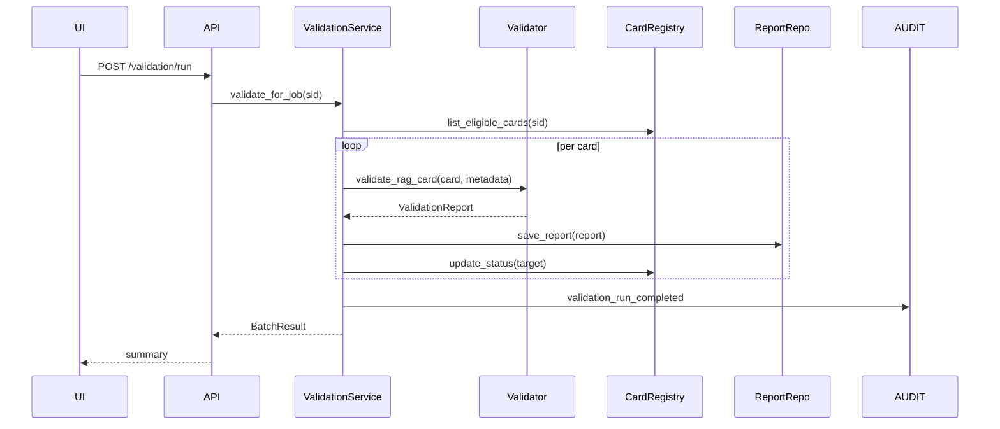

# SETUP-07. Валидация metadata и онтологии

## 1. Назначение фичи

**Краткое название:** SETUP-07. Валидация metadata и онтологии RAG-карточек.

**Краткое описание:** Детерминированная проверка, что у каждой одобренной RAG-карточки есть обязательная metadata, её значения находятся внутри проектной онтологии, ссылки разрешимы и нет дубликатов. Гейтит chunking (SETUP-08).

**Какую проблему решает:** Metadata-driven retrieval работает только при корректной metadata. Опечатка в `doc_type`, неизвестное значение `domain`, пустые `retrieval_tags`, битый `source_document_id` — всё это делает карточку невидимой для retrieval-фильтров. SETUP-07 ловит такие ошибки до того, как Runtime сделает первый запрос.

**Для какого бизнес-процесса:** входит в setup pipeline между SETUP-06 (human review) и SETUP-08 (chunking). После approve карточка → READY_FOR_METADATA_VALIDATION → SETUP-07 → METADATA_VALIDATED → SETUP-08.

**Главный пользовательский результат:** approved карточки автоматически валидируются; для каждой создаётся ValidationReport с типизированными issues; UI показывает статистику и позволяет inline-fix или return-to-review.

---

## 2. Контекст и бизнес-цель

### 2.1. Бизнес-контекст

На входе — карточки в статусах APPROVED / READY_FOR_METADATA_VALIDATION (после SETUP-06). На выходе — METADATA_VALIDATED (готовы к chunking) либо REVIEW_REQUIRED (вернулись к пользователю с конкретными ошибками).

Pain point без SETUP-07: одна "плохая" карточка в индексе портит retrieval для всего setup_job, и обнаружить это можно только по retrieval-тестам в SETUP-10 — слишком поздно.

### 2.2. Бизнес-цель

| Метрика | Целевое значение |
| --- | ---: |
| Доля approved карточек, прошедших validation | ≥ 95% |
| Доля validation reports с типизированным error_code | 100% |
| Идемпотентность повторного прогона | 100% |
| Среднее время валидации одной карточки | < 50 ms |
| Доля карточек в METADATA_VALIDATED без warnings | ≥ 80% |

### 2.3. Инициатор и стейкхолдеры

Initiator: RAG Architect / Product Owner.
Stakeholders: пользователь-настройщик, RAG-администратор, ML Engineer, аудитор.

---

## 3. Термины

| Термин | Определение |
| --- | --- |
| ValidationReport | Иммутабельный отчёт валидатора по одной карточке |
| ValidationCheck | Описание одной выполненной проверки (name, passed) |
| ValidationIssue | Одна проблема: code, field, message, severity, details |
| Validation Status | passed / warning / failed / repair_required |
| Validator Run | Один прогон валидатора по setup_job (создаёт N reports) |
| Batch Result | Сводка: passed / warnings / failed / review_required |

---

## 4. Границы фичи

### 4.1. In Scope

- Прогон validator по карточкам setup_job в статусах GENERATED/REVIEW_REQUIRED/APPROVED/READY_FOR_METADATA_VALIDATION.
- Per-card validation на запрос.
- Persisted ValidationReport.
- 4 типа checks: required fields, ontology values, references, uniqueness.
- 2 policies: STRICT, ALLOW_WARNINGS.
- Status transitions: → METADATA_VALIDATED on passed; → REVIEW_REQUIRED on failed.
- 5 API endpoints.
- Audit events + metrics + structured logs.
- Frontend: ValidationSummaryCard + ValidationReportDrawer.

### 4.2. Out of Scope

- LLM-based auto-repair.
- Semantic duplicate detection.
- Cross-setup_job uniqueness.

### 4.3. Ограничения

- Validator детерминирован, без сетевых вызовов.
- Прогон < 50 ms per card.
- Report иммутабелен.

---

## 5. Пользовательские роли

| Роль | Действия |
| --- | --- |
| Пользователь-настройщик | Видит summary, переходит к report при ошибках |
| RAG admin | Запускает batch validation, force-rerun |
| Auditor | Read-only по reports |
| Domain expert | Inline-fix через возврат в SETUP-06 |

### Permissions

- `kb.rag_card.validation.read` — список + детали reports.
- `kb.rag_card.validation.run` — запуск batch validation.
- `kb.rag_card.validation.refresh` — re-run для одной карточки.

---

## 6. Сервисы

- **MetadataValidationService** — координатор.
- **RAGMetadataValidator** (validators/rag_metadata_validator.py) — engine.
- **ValidationReportRepository** — persisted reports (новый).
- **RAGCardRegistry** — карточки + status transitions.
- **OntologyService** — справочник значений.

---

## 7. Сценарии

### 7.1. Happy path

1. Пользователь нажимает «Запустить валидацию» (или автозапуск после SETUP-06 approve).
2. validate_for_job(sid) → собирает eligible карточки.
3. Для каждой validator прогоняет 4 типа checks → ValidationReport.
4. По policy: passed → METADATA_VALIDATED, warning + STRICT → REVIEW_REQUIRED, failed → REVIEW_REQUIRED.
5. Report сохраняется в repository.
6. Audit + metrics + structured log.
7. UI получает summary: `{total, passed, warnings, failed, review_required}`.

### 7.2. Inline fix

1. Пользователь видит error `UNKNOWN_DOMAIN`.
2. Возврат в SETUP-06 review → edit metadata → fix domain.
3. После edit auto-rerun validate_one(doc_id).
4. Passed → METADATA_VALIDATED → ready for SETUP-08.

### 7.3. Negative

- APPROVED + FAILED → REVIEW_REQUIRED.
- DEPRECATED/REJECTED — пропускаются.
- Validator exception → REPAIR_REQUIRED, статус не меняется.

---

## 8. Sequence diagram

---

## 9. Frontend Scope

- **ValidationSummaryCard** — статистика + кнопка запуска.
- **ValidationReportTable** — список reports с фильтрами severity/code.
- **ValidationReportDrawer** — детали + кнопки «Открыть карточку» / «Перевалидировать».
- **ValidationStep** — wizard step между Review и Tests.

---

## 10. Backend Scope

- ValidationReportRepository (новый): in-memory + snapshot persistence.
- MetadataValidationService rewrite с audit + metrics + events + report persistence.
- 5 endpoints.
- 3 permissions.
- 3 audit actions: `validation.run_triggered`, `validation.report_created`, `validation.issue_resolved`.
- 3 events: ValidationRunStartedEvent, ValidationReportCreatedEvent, ValidationRunCompletedEvent.

---

## 11. DTO

- ValidationReport (есть в schemas/setup/validation_report.py).
- ValidationRunDTO — агрегат прогона (новый).
- ValidationSummaryDTO — счётчики для UI.

---

## 12. API

| Endpoint | Method | Purpose |
| --- | --- | --- |
| `/setup/{sid}/validation/run` | POST | Batch validation |
| `/setup/{sid}/validation/reports` | GET | Список с фильтрами |
| `/setup/{sid}/validation/reports/{doc_id}` | GET | Report по карточке |
| `/setup/{sid}/validation/reports/{doc_id}/refresh` | POST | Re-run одной |
| `/setup/{sid}/validation/summary` | GET | Агрегат |

---

## 13. NFR

- Performance: < 50ms per card.
- Идемпотентность.
- Audit: каждый run + каждая ошибка.
- Безопасность: нет сетевых вызовов, output sanitized.

---

## 14. Acceptance Criteria

### Validation engine

- **AC-01:** Validator detects missing required fields → error.
- **AC-02:** Validator detects ontology violation → error.
- **AC-03:** Validator detects missing source_document_id → warning.
- **AC-04:** Validator detects duplicate doc_id → error.
- **AC-05:** Validator идемпотентен.

### Service

- **AC-06:** validate_for_job обрабатывает eligible карточки.
- **AC-07:** STRICT: warning → REVIEW_REQUIRED.
- **AC-08:** ALLOW_WARNINGS: warning → METADATA_VALIDATED.
- **AC-09:** FAILED → REVIEW_REQUIRED.
- **AC-10:** Validator throws → status не меняется.
- **AC-11:** Report persisted.
- **AC-12:** Audit event на каждый run.
- **AC-13:** Metrics counters обновляются.

### API

- **AC-14:** POST /validate требует `kb.rag_card.validation.run`.
- **AC-15:** GET /reports требует `kb.rag_card.validation.read`.
- **AC-16:** Cross-job isolation (404).
- **AC-17:** Filters по severity/code.
- **AC-18:** Refresh идемпотентен.

### Frontend

- **AC-19:** Summary card actual numbers.
- **AC-20:** Drawer показывает issues с кодами.
- **AC-21:** «Открыть карточку» открывает SETUP-06.

---

## 15. Definition of Done

- 21 AC покрыты тестами.
- Backend: validator + service + repository + 5 endpoints + audit + metrics + logs.
- Frontend: SummaryCard + ReportDrawer + wizard step.
- Traceability + runbook.

---

## 16. Связанные документы

- [SETUP-06 review](SETUP-06-rag-card-review.md)
- [SETUP-08 chunking](SETUP-08-chunking.md)
- [Metadata schema](../../06-rag/metadata-schema.md)
- [Ontology v1](../../../rag/ontology/ontology_v1.yaml)
