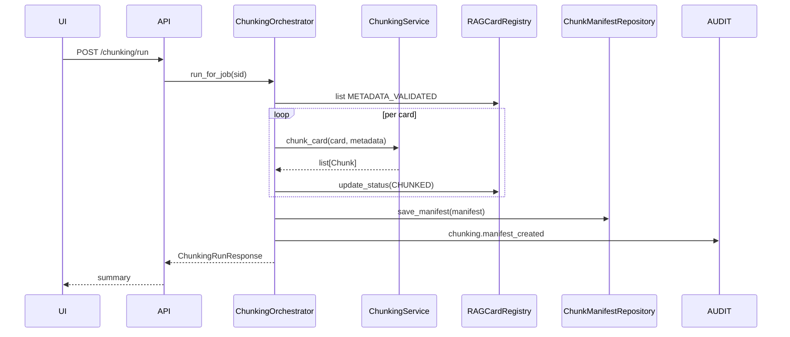

# SETUP-08. Генерация chunks для RAG-индекса

## 1. Назначение фичи

**Краткое название:** SETUP-08. Генерация chunks из METADATA_VALIDATED карточек.

**Краткое описание:** Превращает одобренные и валидированные RAG-карточки в логические chunks (summary, definition, metadata_summary), готовые к embedding и vector indexing. Каждый chunk получает стабильный `chunk_id`, наследует metadata родительской карточки и оптимизированный embedding_text.

**Какую проблему решает:** Embedding целой карточки даёт один размытый вектор. Типизированные chunks позволяют retrieval целиться в нужный слот (например, только summary-chunk нужного `feature_pattern_card`), и драматически улучшают recall@k.

**Для какого бизнес-процесса:** входит в setup pipeline между SETUP-07 (metadata validation) и SETUP-09 (embeddings + vector DB). METADATA_VALIDATED → SETUP-08 → CHUNKED → SETUP-09.

**Главный пользовательский результат:** на UI panel Chunking пользователь видит сколько chunks произведено per-карточка и preview каждого chunk-а (embedding_text, metadata, priority).

---

## 2. Контекст и бизнес-цель

### 2.1. Бизнес-контекст

На входе — карточки в статусе METADATA_VALIDATED (после SETUP-07). На выходе — карточки в статусе CHUNKED, а также `ChunkManifest` per setup_job — детерминированный список chunks для downstream indexing.

Pain point без полной SETUP-08: chunks вычисляются в pipeline в момент `submit_run`, без persistence — пользователь не видит preview и не может оценить качество chunking strategy до запуска embedding.

### 2.2. KPI

| Метрика | Целевое значение |
| --- | ---: |
| Стабильность chunk_id между runs | 100% |
| Доля карточек с ≥ 3 chunks (summary + definition + metadata) | 100% |
| Embedding_text length ≤ CHUNK_CHAR_BUDGET (4000) | 100% |
| Время chunking одной карточки | < 20 ms |
| Доля chunks с непустым retrieval_tags из metadata | ≥ 95% |

### 2.3. Stakeholders

Initiator: RAG Architect. Stakeholders: пользователь-настройщик, ML Engineer (chunk quality), RAG-администратор.

---

## 3. Термины

| Термин | Определение |
| --- | --- |
| Chunk | Логическая единица — `chunk_id`, `chunk_type`, `embedding_text`, `metadata`, `priority` |
| ChunkType | summary / definition / metadata_summary (MVP) |
| ChunkManifest | Per-setup_job list всех chunks: `{setup_job_id, total_chunks, by_type, chunks[]}` |
| ChunkPriority | 0..100; используется при rerank (summary=80, definition=70, metadata=40) |
| Embedding text | Lowercased + collapsed whitespace + cropped до CHUNK_CHAR_BUDGET |
| ChunkPreview | UI-операция: показать что бы получилось, без persistence |

---

## 4. Границы фичи

### 4.1. In Scope

- Прогон chunking по всем METADATA_VALIDATED карточкам setup_job.
- Persistence: ChunkManifest хранится per setup_job + per card.
- Status transitions: METADATA_VALIDATED → CHUNKED.
- API:
  - POST /chunking/run — batch chunk всех eligible карточек.
  - GET /chunking/manifest — full manifest setup_job.
  - GET /chunking/preview/{doc_id} — preview chunks для одной карточки (без persistence).
- Audit events на каждый run.
- Metrics: chunks_created_total, chunks_by_type, manifest_size_bytes.
- Frontend: ChunkPreviewPanel — список chunks с фильтрами + preview drawer.

### 4.2. Out of Scope

- Custom chunking strategies (поддерживается только built-in summary/definition/metadata).
- Per-card override chunk_priority.
- Chunk deduplication между setup_jobs.
- Versioning chunk manifest (всегда latest для setup_job).

### 4.3. Ограничения

- Chunking детерминирован — без LLM-вызовов.
- Stable chunk_id: `{doc_id}#{chunk_type}#{n}` — гарантия идемпотентности.
- Только approved/metadata_validated карточки попадают в manifest.

---

## 5. Роли

| Роль | Действия |
| --- | --- |
| Пользователь-настройщик | Видит counter, открывает preview |
| ML Engineer | Запускает batch chunking, проверяет качество embedding_text |
| RAG-админ | Force-rerun chunking после изменения strategy |
| Auditor | Read-only manifest + previews |

### Permissions

- `kb.chunking.read` — manifest + preview.
- `kb.chunking.run` — batch run.
- `kb.chunking.refresh` — re-chunk для одной карточки.

---

## 6. Сервисы

- **ChunkingService** — stateless engine (уже есть).
- **ChunkManifestRepository** — persisted manifests (новый).
- **ChunkingOrchestrator** — координирует prerun → chunk → save manifest → publish events (новый).
- **RAGCardRegistry** — источник eligible cards.

---

## 7. Сценарии

### 7.1. Happy path

1. Пользователь после SETUP-07 нажимает «Сгенерировать chunks».
2. `chunking_orchestrator.run_for_job(sid)` → собирает METADATA_VALIDATED карточки.
3. Для каждой `ChunkingService.chunk_card()` → list[Chunk].
4. Manifest сохраняется в `ChunkManifestRepository`.
5. Карточки переходят в CHUNKED.
6. Audit `chunking.run_triggered` + `chunking.manifest_created`.
7. Metrics counters обновляются.
8. UI обновляет ChunkPreviewPanel: `{total: 30, by_type: {summary: 10, ...}}`.

### 7.2. Preview без persistence

1. Пользователь открывает карточку до батч-запуска.
2. GET /chunking/preview/{doc_id} → ChunkingService запускает chunk_card,
   возвращает результат, ничего не сохраняет.
3. UI показывает preview в drawer.

### 7.3. Re-chunking после edit

1. Карточка изменена в SETUP-06 (новая версия).
2. POST /chunking/refresh/{doc_id} → re-chunk одной карточки.
3. Manifest обновляется (chunks этой карточки заменяются).

### 7.4. Negative

- Не-METADATA_VALIDATED карточки пропускаются.
- Если `chunk_card` упадёт — карточка остаётся в METADATA_VALIDATED, audit пишет failure.

---

## 8. Sequence diagram

---

## 9. Frontend Scope

- **ChunkPreviewPanel** — agg + кнопка «Run chunking».
- **ChunkListTable** — chunks с фильтрами by type/doc_id.
- **ChunkPreviewDrawer** — chunk_text + embedding_text + metadata + priority.

---

## 10. Backend Scope

- ChunkManifestRepository (новый): in-memory + snapshot.
- ChunkingOrchestrator (новый): координирует run + persistence + events + audit.
- API router: 4 endpoints (run, manifest, preview/{doc_id}, refresh/{doc_id}).
- 3 новых permissions.
- 2 audit actions: `chunking.run_triggered`, `chunking.manifest_created`.
- 2 events: ChunkingRunStartedEvent, ChunkingRunCompletedEvent.

---

## 11. DTO

- ChunkManifestDTO — `setup_job_id`, `chunks` (list), `total_chunks`, `by_type`, `created_at`.
- ChunkPreviewDTO — preview одной карточки без persistence.
- ChunkingRunDTO — агрегат run-а.

---

## 12. API

| Endpoint | Method | Purpose |
| --- | --- | --- |
| `/setup/{sid}/chunking/run` | POST | Batch chunk |
| `/setup/{sid}/chunking/manifest` | GET | Full manifest |
| `/setup/{sid}/chunking/preview/{doc_id}` | GET | Preview без persistence |
| `/setup/{sid}/chunking/refresh/{doc_id}` | POST | Re-chunk одной |

---

## 13. NFR

- Performance: < 20ms per card.
- Идемпотентность: одинаковые карточки → одинаковые chunk_id.
- Audit: каждый run + manifest creation.

---

## 14. Acceptance Criteria

### Chunking engine

- **AC-01:** chunk_id стабилен между runs одной карточки.
- **AC-02:** Каждая карточка даёт ≥ 3 chunks (summary, definition, metadata_summary).
- **AC-03:** embedding_text ≤ CHUNK_CHAR_BUDGET.
- **AC-04:** Chunks наследуют doc_type, version из карточки.

### Orchestrator

- **AC-05:** run_for_job обрабатывает только METADATA_VALIDATED карточки.
- **AC-06:** После успешного chunking status → CHUNKED.
- **AC-07:** Manifest persisted в repository.
- **AC-08:** Audit + metrics + events публикуются.

### API

- **AC-09:** POST /run требует `kb.chunking.run`.
- **AC-10:** GET /manifest требует `kb.chunking.read`.
- **AC-11:** GET /preview/{doc_id} не меняет state.
- **AC-12:** POST /refresh обновляет manifest.

### Frontend

- **AC-13:** ChunkPreviewPanel показывает counters.
- **AC-14:** Preview drawer показывает chunk_text/embedding_text/metadata.

---

## 15. Definition of Done

- 14 AC покрыты тестами.
- Backend: orchestrator + manifest repo + 4 endpoints + audit + metrics.
- Frontend: ChunkPreviewPanel + drawer.
- Traceability + runbook.

---

## 16. Связанные документы

- [SETUP-07 metadata validation](SETUP-07-metadata-validation.md)
- [SETUP-09 embeddings](SETUP-09-embeddings-index.md)
- [Chunk schema](../../06-rag/chunk-schema.md)
