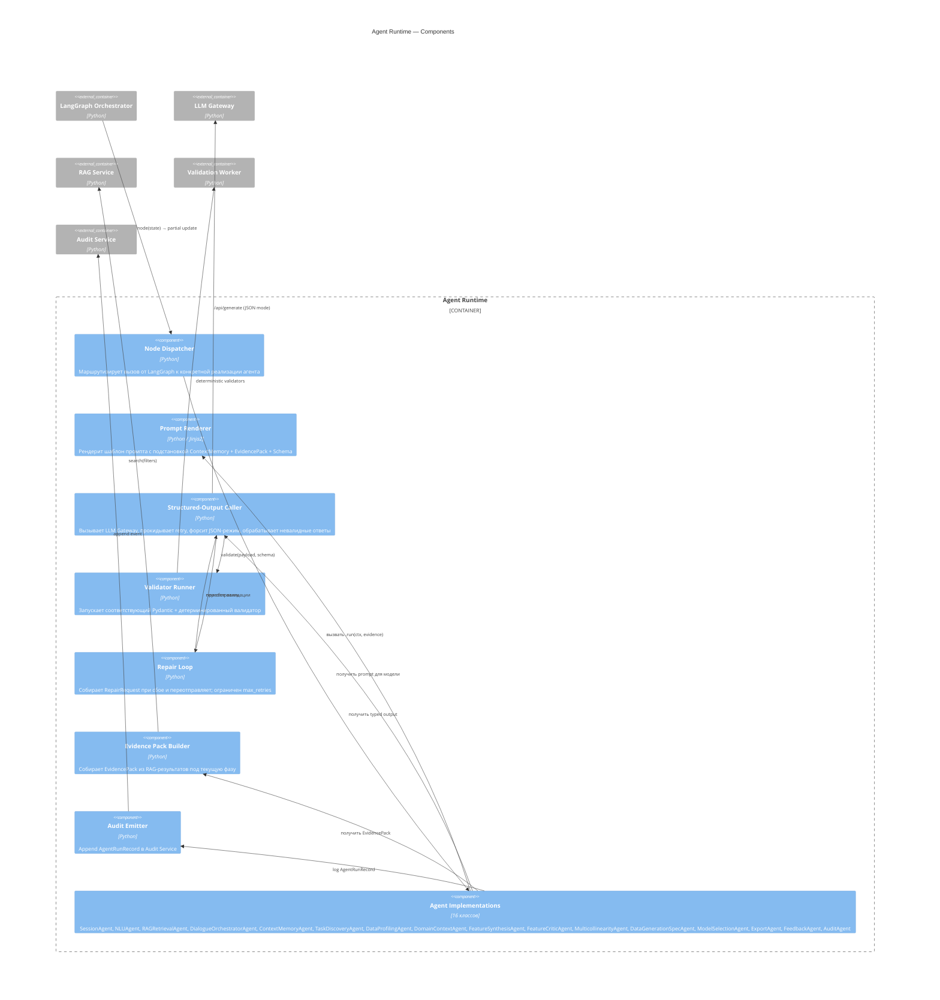

# C4 — Уровень 3: Component (Agent Runtime)

## Назначение

Декомпозировать контейнер Agent Runtime на компоненты, выделить ответственности и направления вызовов. Один компонент ≈ один Python-модуль или один класс высокого уровня.

## Диаграмма (Mermaid)

## Компоненты

### Node Dispatcher

Получает вызов от LangGraph и выбирает реализацию агента по имени узла. Несёт ответственность за изоляцию сбоев: исключение в одном агенте не должно класть Runtime, а должно эмитить структурированную ошибку и возможно триггерить repair или ручной откат фазы.

### Prompt Renderer

Принимает шаблон из `prompts/<agent>.md`, подставляет `ContextMemory`, `EvidencePack` и JSON-schema выхода. Шаблоны version-controlled; версия попадает в audit log.

### Structured-Output Caller

Единая точка вызова LLM из агента. Гарантирует:

- JSON-mode выставлен на стороне Ollama,
- неответ или невалидный JSON триггерит repair,
- `confidence` и `evidence_doc_ids` присутствуют в ответе там, где обязательны.

### Validator Runner

Запускает Pydantic-валидацию + соответствующий детерминированный валидатор (`feature_validator`, `generation_spec_validator`, `context_validator`, ...). Возвращает `ValidationReport`.

### Repair Loop

При сбое валидации формирует `RepairRequest { original_input, previous_output, validation_report }`, переотправляет агенту с явным запретом менять что-либо кроме указанных ошибок. Ограничен `max_retries` (по умолчанию 3).

### Evidence Pack Builder

По фазе и `ContextMemory`-slot'ам запрашивает RAG Service, отбирает top-K чанков, отсекает по `similarity_threshold` и собирает компактный `EvidencePack`. Никаких «сырых» карточек в agent prompt не попадает.

### Audit Emitter

Каждый запуск агента эмитит `AgentRunRecord` в Audit Service: `agent_name`, `phase`, `prompt_template_version`, `llm_model`, `llm_latency_ms`, `retrieved_doc_ids`, `validation_status`, `confidence`, `repair_loop_count`.

### Agent Implementations

16 классов из [AGENTS.md](../../AGENTS.md). Каждый класс наследует общий интерфейс `Agent` с методом `run(ctx, evidence) -> Pydantic`. Спецификации — в [../05-agents/](../05-agents/).

## Связанные документы

- [c4-container.md](c4-container.md)
- [c4-component-rag-service.md](c4-component-rag-service.md)
- [../09-langgraph/state-machine.md](../09-langgraph/state-machine.md)
- [../05-agents/](../05-agents/)
- [../00-methodology/prompt-engineering-rules.md](../00-methodology/prompt-engineering-rules.md)
