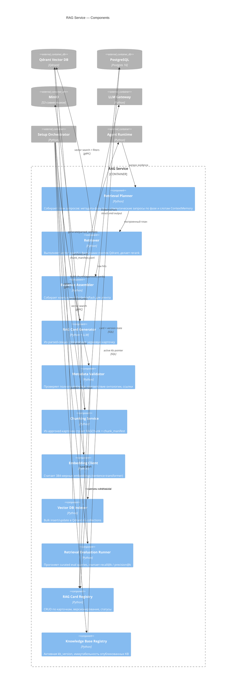

# C4 — Уровень 3: Component (RAG Service)

## Назначение

Декомпозировать контейнер RAG Service: что он делает в Setup-стадии (генерация / индексация / eval) и в Runtime-стадии (retrieval).

## Диаграмма (Mermaid)

## Компоненты

### Retrieval Planner

По текущей фазе и `ContextMemory` строит `RetrievalPlan` — набор подзапросов с metadata-фильтрами (`doc_type`, `phase`, `domain`, `task_type`, `data_source`) и семантическими запросами. Один шаг пользователя может породить несколько подзапросов (например, в `feature_synthesis` — отдельно к `feature_pattern`, `analytics_card`, `schema_card`).

### Retriever

Выполняет план через Qdrant. Делает rerank top-K hits по metadata-сигналам (`confidence_level`, `priority`, `recency`).

### Evidence Assembler

Собирает компактный `EvidencePack`, который агент сможет уместить в контекстное окно (4k–8k токенов). Включает `evidence_doc_ids` для последующей цитации.

### RAG Card Generator

Setup-стадия. По parsed-секции через LLM Gateway черновикует одну карточку соответствующего семейства, проставляет metadata из секции + онтологии.

### Metadata Validator

Детерминированно проверяет: обязательные поля, словари допустимых значений (онтология), целостность ссылок (`source_document_id`, `evidence_doc_ids`).

### Chunking Service

Из approved-карточки производит чанки (`definition`, `inputs`, `outputs`, `formula`, `validation_rules`, `examples`, ...). Эмитит `chunk_manifest.jsonl`.

### Embedding Client

Считает 384-мерные embeddings. Может работать против локального sentence-transformer или прокидывать вызов в Ollama (если выбран embeddings-pathway через Ollama).

### Vector DB Indexer

Bulk upsert чанков с metadata в Qdrant. Изолирует ошибки per-chunk, ведёт `IndexCollection`.

### Retrieval Evaluation Runner

Прогоняет курируемый eval-suite (queries + expected `doc_ids`) против новой `index_version`, считает `recall@k` / `precision@k`. Используется в [SETUP-10](../02-system/features/SETUP-10-retrieval-tests.md).

### RAG Card Registry / Knowledge Base Registry

Stateful слой над PostgreSQL. Версионирует карточки, статусы, KB-версии. Только Knowledge Base Registry знает, какая версия — `active`.

## Связанные документы

- [c4-container.md](c4-container.md)
- [c4-component-agent-runtime.md](c4-component-agent-runtime.md)
- [../06-rag/rag-overview.md](../06-rag/rag-overview.md)
- [../06-rag/retrieval-policies.md](../06-rag/retrieval-policies.md)
- [../06-rag/evidence-pack.md](../06-rag/evidence-pack.md)
