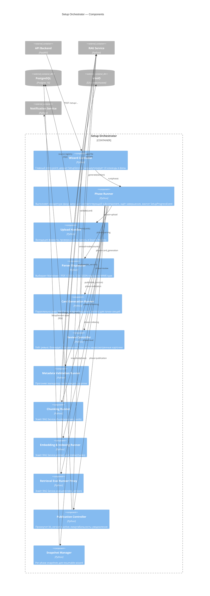

# C4 — Уровень 3: Component (Setup Orchestrator)

## Назначение

Декомпозировать контейнер Setup Orchestrator: компоненты, ответственные за 9 фаз мастера. В отличие от LangGraph (runtime), Setup использует более простой sequential pipeline с явными checkpoints.

## Диаграмма (Mermaid)

## Компоненты

### Wizard Controller

Главный controller, виден API Backend. Держит `SetupSession`, эмитит `SetupProgressEvent` через SSE в UI.

### Phase Runner

Унифицированный исполнитель фазы. Принимает идентификатор фазы и состояние сессии, маршрутизирует к соответствующему subcomponent, ловит сбои фазы (без падения мастера).

### Upload / Parser / Card Gen / Review / Validation / Chunking / Embedding / Eval / Publication Runners

По одному per-фаза. Каждый — тонкий слой над RAG Service / DB / Storage.

### Snapshot Manager

Per-phase snapshots `SetupSession`. Позволяет восстановить мастер после crash или перезахода пользователя.

### Publication Controller

Атомарно промоутит новую `kb_version` в `active`. До успешного завершения retrieval-тестов кнопка публикации скрыта.

## Связанные документы

- [c4-container.md](c4-container.md)
- [c4-component-rag-service.md](c4-component-rag-service.md)
- [../02-system/use-cases/UC-FE-01-build-knowledge-base/use-case.md](../02-system/use-cases/UC-FE-01-build-knowledge-base/use-case.md)
- [../02-system/features/SETUP-01-setup-wizard.md](../02-system/features/SETUP-01-setup-wizard.md)
