# C4 — Уровень 2: Container

## Назначение

Показать FE-Bot как набор контейнеров (отдельно развёртываемых единиц), их обязанности и интерфейсы между ними. Гранулярность: то, что разводится в `infra/compose/docker-compose.yml`.

## Диаграмма (Mermaid)

```mermaid
C4Container
  title FE-Bot — Containers

  Person(user, "Пользователь", "ML-инженер / RAG admin / Product Owner")

  Container_Boundary(fe_bot, "FE-Bot") {
    Container(web_ui, "Web UI", "TypeScript / React (опционально)", "Setup wizard + Runtime chat + Analytics dashboards + Download Manager")
    Container(api_backend, "API Backend", "FastAPI", "Единая HTTP-поверхность, Pydantic-валидация, маршрутизация")
    Container(setup_orch, "Setup Orchestrator", "Python", "Управляет 9 фазами Setup, чёртит state machine ingest-pipeline")
    Container(langgraph_orch, "LangGraph Orchestrator", "Python / LangGraph", "Управляет 7 runtime-фазами, repair-loops, HITL")
    Container(agent_runtime, "Agent Runtime", "Python", "Хостит 16 агентов; рендерит промпты; валидирует выходы")
    Container(rag_service, "RAG Service", "Python", "RAG Retrieval + Card Generator + Card Registry + Evaluation")
    Container(llm_gateway, "LLM Gateway", "Python", "Унифицированный клиент к Ollama; retry; structured-output enforcement")
    Container(data_gen_worker, "Data Generation Worker", "Python (numpy / pandas)", "Производит synthetic dataset из GenerationSpec")
    Container(validation_worker, "Validation Worker", "Python", "Запускает детерминированные валидаторы")
    Container(export_service, "Export Service", "Python", "Сборка archive.zip + metadata.json")
    Container(analytics_service, "Analytics Service", "Python", "Roll-up метрик, чтение Conversation DB / Event Log")
    Container(audit_service, "Audit Service", "Python", "Append-only audit trail + traceability")
  }

  ContainerDb(postgres, "PostgreSQL", "Postgres 16", "Conversations + ContextMemory + audit + registries")
  ContainerDb(qdrant, "Qdrant", "Qdrant", "Vector index + per-collection metadata фильтры")
  ContainerDb(minio, "MinIO", "S3-совместимое", "Artifact Storage (X/y/manifest/archive)")
  Container(ollama, "Ollama", "Ollama runtime", "llama3.2 inference + embeddings (опционально)")

  Rel(user, web_ui, "Использует", "HTTPS")
  Rel(web_ui, api_backend, "REST + SSE", "HTTPS")

  Rel(api_backend, setup_orch, "вызов Setup-фаз")
  Rel(api_backend, langgraph_orch, "POST /chat шаг пользователя")
  Rel(api_backend, analytics_service, "GET аналитики")
  Rel(api_backend, audit_service, "GET audit")
  Rel(api_backend, export_service, "GET архивов")

  Rel(setup_orch, rag_service, "Card Gen / Validate / Chunk / Index / Eval")
  Rel(setup_orch, postgres, "Source / Card / KB registries", "SQL")
  Rel(setup_orch, minio, "Загруженные docs + chunk manifest", "S3 API")

  Rel(langgraph_orch, agent_runtime, "вызвать agent(node)")
  Rel(langgraph_orch, postgres, "ContextMemory checkpoint", "SQL")
  Rel(langgraph_orch, validation_worker, "валидировать output")
  Rel(langgraph_orch, data_gen_worker, "запустить generation")
  Rel(langgraph_orch, export_service, "собрать archive")

  Rel(agent_runtime, llm_gateway, "structured output")
  Rel(agent_runtime, rag_service, "retrieval (EvidencePack)")

  Rel(rag_service, qdrant, "vector search + index", "gRPC")
  Rel(rag_service, postgres, "RAG Card Registry", "SQL")
  Rel(rag_service, minio, "card files + chunk manifest", "S3 API")

  Rel(llm_gateway, ollama, "/api/generate /api/embeddings", "HTTP")
  Rel(data_gen_worker, minio, "X_train.csv / y_train.npy", "S3 API")
  Rel(export_service, minio, "archive.zip", "S3 API")
  Rel(audit_service, postgres, "append events", "SQL")
  Rel(analytics_service, postgres, "read events", "SQL")
```

## Контейнеры

| Контейнер | Технология | Обязанности |
| --- | --- | --- |
| Web UI | React/TypeScript (опционально) | Чат, Setup-мастер, Analytics-дашборды, Download Manager |
| API Backend | FastAPI | Единая HTTP-поверхность, аутентификация, Pydantic-валидация, маршрутизация |
| Setup Orchestrator | Python | State machine 9 фаз Setup |
| LangGraph Orchestrator | LangGraph | State machine 7 runtime-фаз, repair loops, HITL |
| Agent Runtime | Python | 16 агентов: ввод/вывод, рендеринг промптов, validate, repair |
| RAG Service | Python | Retrieval + Card Generator + Card Registry + Evaluation |
| LLM Gateway | Python | Унифицированный клиент Ollama, retry, structured output |
| Data Generation Worker | numpy / pandas / scipy | Производит synthetic dataset из `GenerationSpec` |
| Validation Worker | Python | Детерминированные валидаторы из `validators/` |
| Export Service | Python | Сборка `archive.zip` |
| Analytics Service | Python | Roll-up метрик + queries Conversation DB / Event Log |
| Audit Service | Python | Append-only audit trail, traceability |
| PostgreSQL | Postgres 16 | Сессии, ContextMemory, audit, источники, карточки, KB-версии |
| Qdrant | Qdrant | Векторный индекс, metadata-фильтры |
| MinIO | S3-совместимое | Conversation-scoped artifact storage |
| Ollama | Ollama runtime | LLM inference (плюс опционально embeddings) |

## Опциональные контейнеры (post-MVP)

Каталог DTO ([services/data-transfer-objects.md](services/data-transfer-objects.md)) ссылается на дополнительные хранилища, которые в laptop-MVP **не** разворачиваются и сворачиваются в PostgreSQL или in-process-структуры. Эти контейнеры появляются по мере роста системы. Полная таблица — в [services/storage-conventions.md](services/storage-conventions.md).

| Контейнер | Технология | Когда появляется | DTO, которые он обслуживает |
| --- | --- | --- | --- |
| Redis | Redis 7 | Несколько реплик `app`; нужен shared cache, прогресс jobs, locks, Pub/Sub | DTO-04, DTO-06, DTO-07, DTO-17, DTO-20, DTO-49, DTO-50 |
| ClickHouse | ClickHouse 24+ | Аналитика начинает тормозить PostgreSQL; нужны dashboards с глубиной | DTO-18, DTO-19, DTO-23..27, DTO-48, DTO-49, DTO-51 |
| Kafka | Apache Kafka / Redpanda | Появляются независимые workers с гарантированной доставкой событий | DTO-07, DTO-13, DTO-33, DTO-47, DTO-48, DTO-49, DTO-50 |
| PostgREST | PostgREST 12+ | Нужен административный read-only REST-фасад над PostgreSQL | DTO-01, DTO-03, DTO-17 |

В MVP их функцию выполняют: in-process LRU-cache, отдельная `events`-таблица в PostgreSQL, Python pubsub или PostgreSQL LISTEN/NOTIFY, ручные FastAPI-эндпоинты соответственно.

## Граничные интерфейсы

- **API Backend ↔ UI** — REST + Server-Sent Events для long-running операций (Setup-фазы, Generation, Export).
- **API Backend ↔ оркестраторы** — внутренние Python-вызовы.
- **Agent Runtime ↔ LLM Gateway** — структурированные запросы (system/rules/input/schema) с retry-on-invalid-JSON.
- **Agent Runtime ↔ RAG Service** — `EvidencePack`-запросы с фильтрами по `phase`/`domain`/`task_type`/`data_source`.
- **Setup Orchestrator ↔ RAG Service** — `card_generate`, `card_validate`, `chunk_build`, `index_build`, `retrieval_eval`.
- **Контейнеры ↔ PostgreSQL** — каждый персистирует через свой schema-namespace (`conversation`, `audit`, `source_registry`, `rag_cards`, `knowledge_base`, `events`).

## Связанные документы

- [c4-context.md](c4-context.md)
- [c4-component-agent-runtime.md](c4-component-agent-runtime.md)
- [c4-component-rag-service.md](c4-component-rag-service.md)
- [c4-component-setup-orchestrator.md](c4-component-setup-orchestrator.md)
- [deployment-view.md](deployment-view.md)
- [services/README.md](services/README.md) — детализация контейнеров до 38 логических сервисов (SVC-01..SVC-38)
- [services/mvp-service-set.md](services/mvp-service-set.md) — какие SVC сгруппированы в один процесс в MVP
- [services/data-transfer-objects.md](services/data-transfer-objects.md) — каталог DTO-01..DTO-53
- [services/storage-conventions.md](services/storage-conventions.md) — соглашения по хранилищам и эволюция стека
