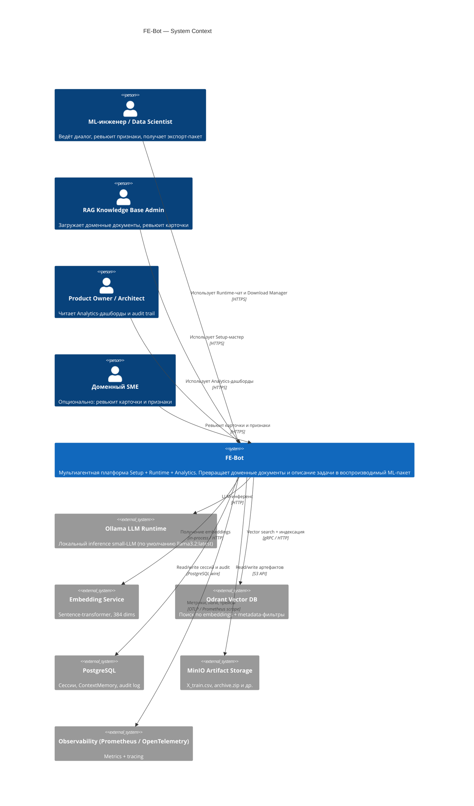

# C4 — Уровень 1: Context

## Назначение

Показать систему FE-Bot как единый чёрный ящик, окружённый внешними акторами и системами, с которыми она обменивается данными.

## Диаграмма (Mermaid)

## Внешние акторы и системы

- **ML-инженер / Data Scientist** — основной runtime-пользователь. Видит чат-UI, прогресс по 7 фазам, обзор признаков и Download Manager.
- **RAG Knowledge Base Admin** — основной setup-пользователь. Видит мастер из 9 фаз, реестр источников, ревью карточек.
- **Product Owner / Architect** — основной analytics-пользователь. Видит дашборды качества, audit trail.
- **Доменный SME** — опциональный участник на ревью карточек ([SETUP-06](../02-system/features/SETUP-06-rag-card-review.md)) и/или подтверждении признаков ([RUNTIME-08](../02-system/features/RUNTIME-08-feature-review.md)).
- **Ollama** — внешний процесс с локальной LLM. Любой вызов LLM из FE-Bot идёт через `LLM Gateway`.
- **Embedding Service** — модель sentence-transformer, размерность 384. Может быть встроена в процесс или вынесена в отдельный сервис.
- **Qdrant** — векторная БД. Хранит embedded-chunks с metadata. Поддерживает фильтры по `doc_type`, `domain`, `task_type`, `data_source`, `phase`.
- **PostgreSQL** — сессии, ContextMemory snapshots, audit log, source registry, RAG card registry, knowledge base registry, event log.
- **MinIO** — объектное хранилище. Conversation-scoped префиксы. Time-bound presigned URLs.
- **Observability** — Prometheus + OpenTelemetry (опционально). Метрики из [docs/11-operations/metrics.md](../11-operations/metrics.md).

## Что НЕ показано здесь

- Внутренние компоненты FE-Bot (см. [c4-container.md](c4-container.md)).
- Реальный поток данных по фазам (см. [c4-component-agent-runtime.md](c4-component-agent-runtime.md), [c4-component-rag-service.md](c4-component-rag-service.md), [c4-component-setup-orchestrator.md](c4-component-setup-orchestrator.md)).
- Развёртывание (см. [deployment-view.md](deployment-view.md)).

## Связанные документы

- [c4-container.md](c4-container.md)
- [deployment-view.md](deployment-view.md)
- [../02-system/system-overview.md](../02-system/system-overview.md)
- [../02-system/actors.md](../02-system/actors.md)
