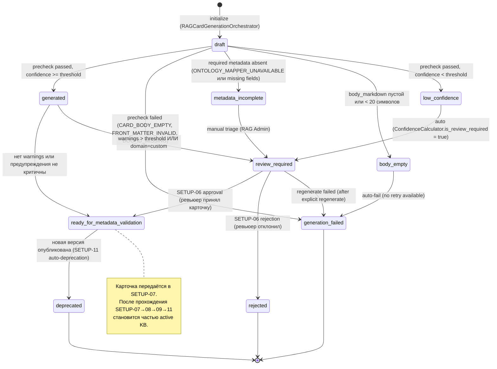

# RAG Card Lifecycle Methodology

Документ описывает lifecycle RAG-карточки от черновика до published состояния применительно к SETUP-05 и последующим этапам: статусы, переходы, versioning, регенерация, deprecation.

---

## 1. Назначение

RAG-карточка — основная управляемая единица знания в FE-Bot Knowledge Base. Прежде чем попасть в активный vector index, карточка проходит контролируемый lifecycle: от `draft` (создан черновик) через генерацию, review и валидацию metadata — до `ready_for_metadata_validation` (передача в SETUP-07). Каждый переход фиксируется в audit log и порождает событие через `EventBus`.

Документ является обязательной спецификацией для:
- `RAGCardGenerationOrchestrator` (SETUP-05) — присваивает статусы при генерации;
- SETUP-06 Review Service — переводит в `ready_for_metadata_validation` или `rejected`;
- SETUP-07 Metadata Validation Service — принимает `ready_for_metadata_validation`;
- SETUP-09 Vector Indexer — исключает `draft`, `review_required`, `rejected`, `deprecated`;
- SETUP-11 Publish — auto-`deprecated` старых версий при публикации новой KB version.

---

## 2. Статусы

Каждая RAG-карточка в системе имеет ровно один из 10 статусов закрытого перечня `CardStatus`. Значения и их семантика:

| Статус | Назначение | Кто устанавливает | Кто читает |
|---|---|---|---|
| `draft` | Карточка создана как черновик; генерация ещё не завершена | `RAGCardGenerationOrchestrator` (начало pipeline) | UI Preview (read-only) |
| `generated` | Карточка успешно сгенерирована; все required fields заполнены; precheck пройден | `RAGCardGenerationOrchestrator` (после `CardValidationPrecheck.check()`) | UI, `RAGCardRegistry` |
| `generation_failed` | Ошибка генерации: пустой body, невалидный LLM output после 3 retry, ошибка сохранения artifact | `RAGCardGenerationOrchestrator` (per-section fallback) | UI Errors Panel; RAG Admin для regenerate |
| `metadata_incomplete` | Required metadata отсутствует: `domain`, `phase`, `retrieval_tags` или другие поля не заполнены | `RAGCardGenerationOrchestrator` (после `OntologyMapper.validate_card_metadata()`) | SETUP-07 Validation Service; UI |
| `body_empty` | Markdown body пустой или короче 20 символов | `RAGCardGenerationOrchestrator` (precheck `CARD_BODY_EMPTY`) | UI; auto-retry |
| `low_confidence` | `confidence_score < confidence_threshold` (дефолт 0.7); карточка создана, но ненадёжна | `ConfidenceCalculator` | UI LowConfidenceCardsPanel |
| `review_required` | Требуется ручной review: low confidence, warnings, `domain=custom`, `metadata_incomplete` после triage | `RAGCardGenerationOrchestrator` или SETUP-06 Review Service | SETUP-06 Review UI |
| `ready_for_metadata_validation` | Карточка прошла precheck и review (или review не требовался); передана в SETUP-07 | `RAGCardGenerationOrchestrator` (при `confidence >= threshold` и `precheck.passed`) или SETUP-06 approval | SETUP-07 Metadata Validation Service |
| `rejected` | Карточка отклонена ревьюером в SETUP-06; не участвует в downstream pipeline | SETUP-06 Review Service | Audit Log; UI (read-only) |
| `deprecated` | Карточка устарела: опубликована новая версия или admin выполнил deprecation | Admin / RAG Admin (ручной) или SETUP-11 (автоматически при публикации новой KB version) | `RAGCardRegistry` для audit; Vector Indexer (исключение) |

**Жёсткие ограничения по использованию:**
- Карточки в статусах `draft`, `review_required`, `rejected`, `deprecated` НИКОГДА не попадают в active Knowledge Base и не индексируются в Vector DB (SETUP-09 фильтрует их при построении chunk manifest).
- Карточки без `source_document_id` и `source_section_id` не могут выйти из `draft`.
- Карточки без `doc_id` не передаются в SETUP-07; без `doc_type` не передаются в SETUP-08.

---

## 3. Диаграмма переходов



**Примечание по возвратным переходам.** В отличие от `rag-lifecycle.md` (общая lifecycle KB), SETUP-05 не реализует переход `review_required → draft` напрямую. Вместо этого пользователь вызывает `regenerate`, что создаёт новую `card_version` в статусе `draft`. Старая версия сохраняется как есть. Возврат назад по lifecycle не реализован в MVP.

---

## 4. Versioning policy

### 4.1. Ключевые понятия

- `doc_id` — логический идентификатор карточки, стабильный на протяжении всей её жизни. Формат: `{doc_type_short}.{slug(title)}.v{N}` (генерируется `DocIdGenerator`). Пример: `analytics.sensor_uptime_ratio.v1`.
- `card_version` — монотонно возрастающий номер конкретной редакции карточки. Формат: `"1.0"`, `"2.0"`, `"3.0"`. Каждая регенерация инкрементирует `card_version`. Major bump (сдвиг первой цифры) — при breaking metadata schema change, требующем изменения `metadata_schema_version`.
- Уникальность карточки в `RAGCardRegistry` задаётся ключом `(doc_id, card_version)`.

### 4.2. Правила версионирования

- Старая версия НЕ удаляется из `RAGCardRegistry` при создании новой. Она остаётся в registry для audit и трассируемости.
- В active Knowledge Base (SETUP-11) может быть только одна активная версия на `doc_id`.
- При публикации новой KB version старые версии карточек auto-`deprecated` через SETUP-11.
- `deprecated` версия не участвует в новых vector indexes и не возвращается в retrieval.
- Добавление optional metadata fields — backward-compatible. Изменение обязательных полей требует новой `metadata_schema_version` и явной миграции.

### 4.3. Формула генерации doc_id

```
doc_id = {doc_type_short}.{slug(title)}.v{N}

doc_type_short маппинг:
  schema_card          → schema
  task_card            → task
  analytics_card       → analytics
  field_definition_card → field
  feature_pattern_card → pattern
  validation_rule_card → validation
  question_template_card → question

slug(title): lower + ASCII transliteration + replace non-alnum с '_' + truncate 50 chars
N: 1 для первой версии; инкрементируется при конфликте doc_id
```

---

## 5. doc_id conflict resolution

Конфликт `doc_id` возникает, когда `DocIdGenerator` формирует идентификатор, уже существующий в `RAGCardRegistry`. Правила разрешения:

1. `DocIdGenerator.generate_doc_id(doc_type, title, existing_doc_ids=...)` проверяет `existing_doc_ids` через `RAGCardRegistry.list_versions(doc_id_base)`.
2. При конфликте автоматически инкрементируется суффикс `N`: `.v1` → `.v2` → `.v3`. Конфликт не является ошибкой при наличии свободного суффикса.
3. Hard конфликт (разные карточки с семантически одинаковым content, но разными `section_id`): генерирует `WARNING_ONTOLOGY_UNKNOWN_TERM`-подобный warning и отправляет карточку в `review_required` для ручного разбора.
4. `DOC_ID_CONFLICT` error code выставляется только если `DocIdGenerator` не может найти свободный суффикс (ограничение max attempts — конфигурируемо).

---

## 6. Regenerate flow

Регенерация позволяет пересоздать карточку из той же parsed section (например, при улучшении prompt template или обновлении ontology) без разрыва source trace.

1. User или RAG Admin инициирует `POST /api/v1/setup/{setup_job_id}/rag-cards/{doc_id}/regenerate` (требует permission `KB_RAG_CARD_REGENERATE = "kb.rag_card.regenerate"`).
2. `RAGCardGenerationOrchestrator.regenerate_card(setup_job_id, doc_id, *, requested_by, reason, override_doc_type=None)` загружает существующую карточку — берёт `source_document_id` и `primary_source_section_id`.
3. Запускается single-section generation pipeline (мини-job со статусом `COMPLETED` после одного цикла): `DocTypeDetector → MetadataExtractor → OntologyMapper → PromptTemplateRegistry → LLMCardAdapter → MarkdownBuilder → CardValidationPrecheck → ConfidenceCalculator → DocIdGenerator`.
4. Новая карточка получает `card_version = old_card_version + 1` (numeric increment). Статус начинается с `draft`, затем присваивается по итогам precheck и confidence.
5. Старая версия остаётся в `RAGCardRegistry` с прежним статусом. Она НЕ помечается `deprecated` автоматически на этом шаге (только SETUP-11 auto-deprecated при публикации).
6. Source trace (`source_document_id`, `primary_source_section_id`) не изменяется — regenerate всегда привязывается к той же parsed section.
7. Публикуется audit event `RAG_CARD_REGENERATE_TRIGGERED` с полями `actor_id`, `target_type="rag_card"`, `target_id=doc_id`, `reason`, `old_card_version`, `new_card_version`.
8. Если regenerate завершился `generation_failed` — старая версия остаётся нетронутой; статус `review_required` не снимается.

**Ограничения:**
- `reason` обязателен; пустая строка не допускается.
- Regenerate approved карточек требует отдельного permission (не входит в `KB_RAG_CARD_REGENERATE`; зарезервировано для отдельного scope в следующей итерации).
- При активном `generation_job` (status ∈ {CREATED, QUEUED, RUNNING}) regenerate возвращает 409 `RAG_CARD_GENERATION_ALREADY_RUNNING`.

---

## 7. Lineage

Каждая RAG-карточка связана со своим источником через `RAGCardSourceLinkDTO` (DTO-63).

- **parsed_section → rag_card:** relation type `GENERATED_FROM`. Создаётся через `source_link_repo.link(doc_id, card_version, source_document_id, source_section_id, relation_type=GENERATED_FROM)`.
- **source_document → rag_card:** transitive lineage (через `source_document → parsed_section → rag_card`). Обновляется вызовом `SourceLifecycleService.link_artifact(source_document_id, target_type=RAG_CARD, target_id=doc_id, relation_type=GENERATED_FROM)`.
- Lineage хранится в `RAGCardSourceLinkRepository` (in-memory MVP; PostgreSQL `rag_card_source_links` — production) и в `SourceLineageRelation` через `SourceLifecycleService`.
- Операция `link()` идемпотентна по ключу `(doc_id, card_version, source_section_id, relation_type)`.
- Lineage доступен через `GET /api/v1/setup/{setup_job_id}/rag-cards/{doc_id}/preview` (поле `source_trace`) при наличии permission `KB_RAG_CARD_LINEAGE_READ = "kb.rag_card.lineage.read"`.

---

## 8. Deprecation

Карточка переводится в `deprecated` двумя способами.

**Manual deprecation:**
- Admin или RAG Admin выполняет regenerate с reason = `"deprecated_by_admin"` или явно вызывает admin endpoint (будущий; в MVP через regenerate).
- Переход: текущая версия → `deprecated`; новая версия создаётся в `draft`.

**Automatic deprecation (SETUP-11):**
- При публикации новой KB version `KBPublisher` auto-`deprecated` все предыдущие версии карточек, вошедших в новую Knowledge Base.
- Алгоритм: для каждой карточки в новой KB version — найти все `card_version < current_published_version` и перевести в `deprecated`.
- Карточки, не вошедшие в новую KB version (rejected, failed), не затрагиваются.

**Последствия deprecated:**
- `deprecated` — терминальный статус. Переходов из него нет.
- Deprecated карточки не индексируются Vector DB (SETUP-09 фильтрует по `status NOT IN ('draft', 'review_required', 'rejected', 'deprecated')`).
- Deprecated карточки остаются в `RAGCardRegistry` и Object Storage (`rag/cards/{setup_job_id}/{doc_id}.md`) для audit и исторической трассируемости.
- Из `deprecated` состояния можно породить новую версию только через явный `regenerate` (создаёт новую `card_version` в `draft`, не меняет deprecated-версию).

---

## 9. Связь со SETUP-06/07/11

### SETUP-06 — Review RAG-карточек

- Принимает на вход карточки в статусе `review_required`.
- Ревьюер (RAG Admin, Domain Expert, ML Engineer) просматривает metadata, Markdown body, source trace, precheck report.
- Действия ревьюера:
  - **Принять** → `review_required → ready_for_metadata_validation`.
  - **Отклонить** → `review_required → rejected`.
  - **Запросить регенерацию** → вызывает `regenerate_card()` → новая `card_version` в `draft`; при failure → `generation_failed`.
- SETUP-06 не изменяет `card_version`; только меняет статус существующей версии.

### SETUP-07 — Валидация metadata

- Принимает на вход карточки в статусе `ready_for_metadata_validation`.
- Выполняет deep validation: проверка соответствия всех metadata полей `ontology_v1.yaml`, наличие required fields по doc_type, корректность `agent_targets` из AGENTS.md.
- При failure deep validation: карточка возвращается в `review_required` с детальными warnings (список полей с проблемами). Это возвратный переход, допустимый только из SETUP-07.
- При success: карточка готова к SETUP-08 (chunking).

### SETUP-11 — Публикация Knowledge Base

- Принимает на вход карточки, прошедшие полный pipeline (SETUP-07 → SETUP-08 → SETUP-09).
- При публикации новой KB version:
  - Старые `card_version` для doc_id, вошедших в новую версию, автоматически переводятся в `deprecated`.
  - Статус `published` в терминах этого документа соответствует вхождению в `KnowledgeBaseVersion.status = active`.
- `KnowledgeBaseVersion` (DTO-17) иммутабельна: правки идут через новую KB version.

---

## 10. Audit и Observability

### 10.1. Audit events

Каждый переход статуса публикует `AuditAction.RAG_CARD_STATUS_CHANGED` через `AuditService` с полями:

| Поле | Значение |
|---|---|
| `actor_id` | ID пользователя или `"rag_card_generation_service"` для автоматических переходов |
| `target_type` | `"rag_card"` |
| `target_id` | `doc_id` |
| `payload.old_status` | Предыдущий статус |
| `payload.new_status` | Новый статус |
| `payload.card_version` | Версия карточки |
| `payload.reason` | Причина (для `rejected`, `deprecated`, `review_required`) |
| `payload.setup_job_id` | ID setup job |

Специализированные audit actions:

| Action | Когда |
|---|---|
| `RAG_CARD_GENERATION_TRIGGERED` | При создании `RAGCardGenerationJob` |
| `RAG_CARD_GENERATED` | При успешной генерации каждой карточки (per card) |
| `RAG_CARD_REGENERATE_TRIGGERED` | При вызове `regenerate_card()` |
| `RAG_CARD_REVIEW_REQUIRED` | При переводе карточки в `review_required` |

### 10.2. Метрики

| Метрика | Тип | Labels | Назначение |
|---|---|---|---|
| `rag_card_status_transitions_total` | Counter | `from_status`, `to_status` | Статистика переходов lifecycle |
| `rag_cards_generated_total` | Counter | `doc_type`, `confidence_bucket` | Успешные генерации |
| `rag_cards_failed_total` | Counter | `error_code` | Ошибки по типу |
| `rag_cards_review_required_total` | Counter | `doc_type` | Low confidence карточки |
| `rag_card_generation_duration_ms` | Histogram | `outcome` | Время генерации |
| `rag_card_time_in_status_ms` | Histogram | `status` | Время нахождения в каждом статусе |

### 10.3. Structured logging

Per-card log record (при каждом переходе статуса):
```json
{
  "generation_job_id": "...",
  "section_id": "...",
  "doc_id": "...",
  "doc_type": "...",
  "old_status": "...",
  "new_status": "...",
  "card_version": "...",
  "confidence_level": "...",
  "duration_ms": 0,
  "outcome": "...",
  "prompt_template_version": "...",
  "ontology_version": "..."
}
```

---

## Связанные документы

- [rag-methodology.md](rag-methodology.md) — RAG-first манифест; metadata-aware knowledge workflow
- [rag-lifecycle.md](rag-lifecycle.md) — KB version lifecycle (chunked → embedded → indexed → published)
- [metadata-schema.md](metadata-schema.md) — `rag_metadata_v1`; required/optional поля по doc_type
- [document-types.md](document-types.md) — 13 типов RAG-карточек
- [retrieval-policies.md](retrieval-policies.md) — per-agent retrieval policies; фильтрация по `doc_type`, `phase`, `agent_targets`
- [rag-quality.md](rag-quality.md) — validation gates; `recall@5 ≥ 0.85`, `precision@5 ≥ 0.7`
- [../02-system/features/SETUP-05-rag-cards-generation.md](../02-system/features/SETUP-05-rag-cards-generation.md) — feature spec; бизнес-правила BR-01..20; AC-01..51
- [../03-architecture/services/data-transfer-objects.md](../03-architecture/services/data-transfer-objects.md) — DTO-59..66
- [../implementation-plan/SETUP-05.tasks.md](../implementation-plan/SETUP-05.tasks.md) — scope decisions 2026-06-19; 42 задачи в 8 слайсах
